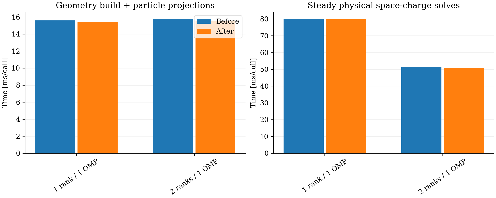

# FFT2D5 cleanup: stage boundaries and CPU verification

The cleanup removes the compile-time IPPL comparison backend and its parameter wiring. The native cell-integrated free-space model remains the sole FFT2D5 transverse backend. The unused scalar line-density operator and stale numerical/diagnostic comments are removed. MPI Green initialization now allocates the workspace for its one transform; the single-rank row path allocates none of that unused scratch. No IPPL library, moment calculation, physics model or numerical tolerance is changed.

## Smaller methods

| Orchestrator | Before → after [source lines] | Subfunctionality |
|---|---:|---|
| `solveBatched` | 218 → 20 | Validate grid/indices; prepare buffers and Green; cache row plans; pack, transform, multiply and extract |
| `preparePathGeometryAndProjections` | 191 → 19 | Resize caches; build segments; build ordered-prefix hierarchy; project active containers |
| `migrateToSlabs` | 68 → 7 | Check domain; save logical coordinates; migrate ownership; restore Cartesian attributes/BC |

The new helpers stay in existing classes/files. CUDA-launching helpers remain public because of NVCC extended-lambda accessibility; their Doxygen marks them internal. Segment scoring, prefix addition order, box merges, tie breaking and stack fallback are retained. Deposition, line-density assembly, diagnostic serial/MPI slice paths and gathering are also separated into smaller responsibilities. The standalone benchmark separates validation and timing sweeps from each candidate's numerical stages.

Doxygen's XML source inventory finds no FFT2D5 production method above 56 lines. The remaining 56-line method is the existing exhaustive Cartesian-to-path conversion; the largest new helper is at most 51 lines. Benchmark helpers are also below one page. The definition counts include signature/internal comments and blank lines, excluding preceding Doxygen. See `function-sizes.csv` for actual source spans. Doxygen generation reports no warnings with internal documentation enabled, and all 86 new-function candidates have entries. Public configuration accessors, halo operations and mathematical helpers now have contracts rather than implicit or stale comments.

## Build and unit checks

Build directory: `/Users/adelmann/git/opalx/build-omp`, Release/OpenMP. The old executable is preserved at `src/opalx.pre-cleanup-20261107`, SHA256 `e77830e07e695f84baa45db5dc5c67a1fcafdb92dc84e4cec9254a38c0853e1c`. The cleanup binary is `src/opalx`, SHA256 `a26d0c24843d468e5315aa2c41e8c22740b41814b6a10fa0f5371c6f2488979f`. The source base is `e5f190d3b`, plus local cleanup edits. Both binaries are retained; no remote build is made for this step.

The six focused CTest targets pass with one and four OpenMP threads: `TestSpaceChargeConfig`, `TestFFT2D5Algorithm`, `TestFFT2D5Numerics`, `TestSpaceChargeSolver`, `TestPoissonSolver`, and `TestFFT2D5Parallel`. Both parallel tests also pass on two MPI ranks at each thread count. The exact serial-build/exhaustive geometry and projection checks remain unchanged. The standalone benchmark's 78 validation rows pass; maximum relative field error is 9.21×10⁻¹⁵ and potential error 4.21×10⁻¹⁶. No references or tolerances were relaxed.

## Same 100-step pilot

The paired CPU pilots use one OpenMP thread per rank, one/two MPI ranks, 100,000 matched particles, 5.602212334 nC, a 64×64×512 mesh, dt=3 ps, batch size 64 and the original OPEN longitudinal model. Both sides restart the same checkpoint and retain the original input settings.

| MPI ranks | Process wall before → after [s] | Steady SC before → after [ms/call] |
|---:|---:|---:|
| 1 | 16.280 → 16.153 | 79.972 → 79.777 |
| 2 | 8.962 → 8.874 | 51.407 → 50.687 |

Each configuration has one pair; the small timing differences do not establish a speedup. All 100,000 IDs, charge and final times are preserved. RMS and emittance differences are below 1.69×10⁻¹⁴ relative. Maximum endpoint position difference is 3.40×10⁻¹³ m and momentum difference 1.10×10⁻¹². Tracking is equivalent at reduction roundoff, rather than bitwise identical.

Inputs, logs, statistics, runner commands, executable identities and audits are retained under `provenance`. Particle snapshots remain in `/Users/adelmann/git/opalx/tmp/2026-11-07-fft2d5-cleanup`; none are placed in this report. Reproduce with `analyze.py` in the OPALX Python environment, setting `OPALX_GEOMETRY_ROOT` if the native/cache directory differs.

This step verifies the cleanup on CPU. CUDA compilation and GPU execution have not been repeated after the method split; the CPU checks do not substitute for that validation. No full-turn or 16-turn runs were made. Code/results remain local and uncommitted.
