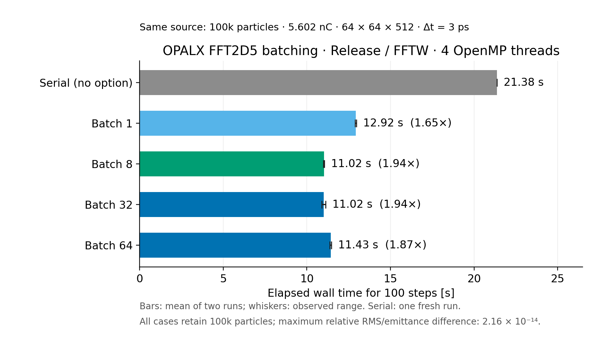
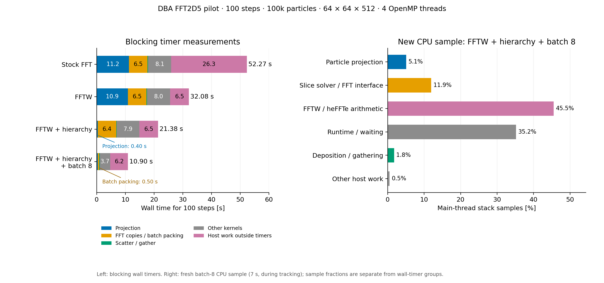

# OPALX FFT2D5 slice batching

Use `~/git/opalx/build-omp/src/opalx case.in --2D5BatchSize 8`. The argument must be a positive integer. Without it, the existing serial slice path remains active. Batch sizes1,8,32and64 were compared using one executable built in `~/git/opalx/build-omp`, Release/OpenMP with FFTW3.3.11. No IPPL source was changed. No16turnruns were started.

| Batch size | Mean wall time [s] | Observed range [s] | Speedup vs serial |
|---|---:|---:|---:|
| Serial (no option) | 21.37616 | 21.37616–21.37616 | 1.000× |
| 1 | 12.92444 | 12.88820–12.96068 | 1.654× |
| 8 | 11.01981 | 10.99174–11.04787 | 1.940× |
| 32 | 11.01816 | 10.90263–11.13369 | 1.940× |
| 64 | 11.42569 | 11.37826–11.47312 | 1.871× |

Serial is one fresh run; each explicit batch size has two unprofiled repeats. Batch8 and32 are effectively tied at11.02s (about48.4% less time than serial). Prefer8 for this setup because its contiguous real and spectral buffers need2.02MiB, versus8.06MiB for32 (both exclude backend workspace and the shared Green spectrum). Batch64 is slightly slower in these measurements. The two-repeat ranges do not establish a statistically significant difference between8and32.

## What changed

The existing OPALX slice solver packs a bounded group of occupied slices into contiguous zero-padded buffers, calls the existing native heFFTe batched real-to-complex transform, multiplies by the unchanged cell-averaged Green spectrum and calls the inverse. A batched centered-gradient kernel reads neighbours directly from the doubled potential, including the wrapped free-space halo, and writes the existing3D staging field. The3D array is only storage: no longitudinal FFT or coupling between slices was introduced.

The forward transform retains full normalization and the inverse remains unscaled, with the original source-cell-area and electrostatic coupling factors. Plans and buffers persist across calls; actual final-batch counts handle remainders. Buffer capacity is bounded by requested batch size and physical slice count. Empty/vacated slices are cleared; neutral slices with nonzero cell densities remain active. Diagnostic policies retain the serial path and its per-slice potential callbacks. Batch execution currently supports host memory and one MPI rank; GPU batching is explicitly rejected and untested. The FFT arithmetic within a native batch remains sequential, while the surrounding kernels use OpenMP.

IPPL's R2C Field adapter does not expose batching, so OPALX uses the already installed native heFFTe API via IPPL's existing backend/type/options definitions. IPPL source and its copy routines were left unchanged. One auxiliary OPALX fix was needed: when transverse grid dimensions change, Field::initialize does not resize existing arrays; the solver now uses the existing updateLayout API. The command-line parser accepts the option before/after the input, reports invalid values even at info0, and prints OPALX help before IPPL can intercept its help aliases.

## Results and checks

All runs use the identical100-step DBA pilot:100,000 matched KV particles,5.602212333965894nC,64×64×512 mesh,3ps steps,4OpenMPthreads/1MPIrank, original transverse model, longitudinal field disabled and all PARFFT flagsFALSE. Exact input SHA f6692da8991aadf01282f7811183427c78e649ac5266c3b11bb5ecf813185f38; checkpoint SHA4d6adf38da35d9168f9cdb10847786eb1ea64d27e13e521211173901037e19f5. Arguments, source identity and timings are recorded per run. The new default serial path reproduces the earlier preserved executable's21.27–21.81s timing range.

Every run retains all100,000IDs, correct total charge, finite state and final300ps/globalstep99. Relative to the fresh serial run, maximum lab position difference is4.7000e-13m and momentum difference1.7976e-12beta-gamma, or0.00334% of the reference SC kick scale. All10statRMS/emittance samples have maximum relative difference2.1560e-14. Existing QA bounds1e-9m,1e-10beta-gamma,0.1%SCkick and1e-8relativeRMS/emittance pass. No physics tolerance was relaxed; complete tracking is equivalent at floating-point reduction roundoff, not bit-for-bit.

The new direct unit test compares full potential including transverse halos, allEcomponents and an independent copy of the unchanged source with the serial solver for sizes1/8/32/64. It covers66active slices out of73, partial batches, empty and vacated slices, neutral sources,6×8and8×6anisotropic grids and spacing changes. The full-solver test comparesE/Band solve counts under open/closed longitudinal boundary modes. The existing neutral-slice test now runs both serial and batched paths. Four CTest targets pass with OMP1andOMP4; the existing two-rank rejection test also passes. Ten CLI checks cover positive arguments, argument placement, missing/malformed/zero/negative/overflow values and both help aliases. Doxygen generation reports zero warnings. Product diff reviewed and unrelated working files preserved.

A separate batch8 kernel profile took10.95559s. Across100solves it recorded6400pack,6400Green-multiply and6400field-output kernels. Their total measured blocking time was0.91565s (packing0.50063s, multiplication0.17409s, field output0.24093s). The previous per-slice FFT_toTemp/fromTemp calls disappeared; only six of each remain for initial setup/Green computation. A later fresh CPU-stack sample is recorded below. Worker-thread FFT parallelism is not established by these results.

## Provenance and reproduction

Base source commit a1ad007c8f3a761c39827ea0e06f19feefcc8f74 plus the scoped local source patch; source diff SHA256 f049d6ae288487c2e8874da79a3e7e23dbc46045ab87f9acdeef5292d77167b2. Current executable SHA256 4d627521ac4f33e2ba54d7e5b605a5fc536a41673b69c58fc28e3b04cb17e1ec. Previous executable preserved byte-for-byte at `/Users/adelmann/git/opalx/build-omp/previous/opalx-d2c0add433c4-serial-slices`, SHA256 d2c0add433c40f47557d354323093f1d3949835defff5945bcb7337e7223f4d1. Every new serial/batch run used the current executable, with only the batch argument changing. The source files have not changed since the benchmark build; only the input-invariance test was strengthened afterward and rebuilt/rechecked.

Raw outputs and reproducible scripts: `/Users/adelmann/git/dba-lattice/comparison-20261104/unified-current/dba-fftw-batching` and its parent. Initial checkpoint and particle dumps are kept there, not copied into this report archive. The archived scripts retain their original raw-directory assumptions; external checkpoint data are required. The archive includes the exact input, per-run arguments/manifests/logs, comparisons, tests, source patch and figure. Generated Doxygen output is excluded. The measured sources were subsequently committed as `a28af04173af9c9e122891c7b6c4f8d8d387ac16`; the executable was built before that commit from the recorded base and patch, whose source contents match the commit.

## Batch-8 CPU profile and cumulative timing plot

The combined plot adds batch8 to the existing stockFFT/FFTW/hierarchy timing bars and replaces the right-hand panel with a fresh batch8 CPU sample. The left-hand10.90s bar is the native mainTimer from the earlier independent kernel-profiled run (10.95559s process elapsed). The fresh CPU-sampled run took11.38491s. Sampling starts after tracking step0:7seconds at2ms intervals. This shorter steady-tracking window is indicative; its percentages must not be added to whole-run wall-timer groups.

Main-thread exclusive samples: FFTW/heFFTe arithmetic45.51%, runtime/waiting35.20%, slice-solver/FFTinterface11.94%, particleprojection5.09%, deposition/gathering1.76%, otherhost0.51%. Three OpenMP workers spend85.86% of sampled stacks in runtime/waiting. The same call-path attribution rules are used as in the earlier plots.

All100,000IDs, correct charge, finitearrays and final300ps/globalstep99 verified against the fresh serial reference. Max labposition difference3.482e-13m, momentum1.093e-12beta-gamma; RMS/emittance relative differences≤1.163e-14. Binary/source identities remain frozen. No source change, rebuild or16turnrun.

## One-turn runtime estimate

At3ps, one DBA turn (period1.17971872e-06s) needs393,240steps. The measured batch8 tracking rate is0.0915509s/step after subtracting one-time reference initialization. This extrapolates to about10.0hours per turn; use10–12hours for planning on this laptop. It is not a full-turn measurement and does not establish sustained thermal performance or evolved-beam cost. No full-turn or16-turn run has been made.

## Sixteen-thread trial and FFTW thread capability

The same executable and batch8 pilot with16OpenMPthreads took12.35867s and12.40490s: mean12.38179s versus11.01981s with4threads (12.36% slower). Startup confirms OpenMP maxthreads16, dynamicteams0 and Kokkos concurrency16. Both runs retain all particles/charge and pass the same endpoint/stat bounds; maximum relative RMS/emittance difference is2.232e-14. Keep4threads for the current setup.

The installed FFTW3.3.11 supports OpenMP, but the production OPALX/heFFTe path does not call fftw_init_threads or fftw_plan_with_nthreads. Its FFT arithmetic therefore uses the default single-thread plans; OMP_NUM_THREADS changes the surrounding Kokkos kernels. A separate installed-library128×128round-trip probe accepted planner maxima1/4/16 and returned maximum error1.111e-15 in every case. This confirms capability, not a measured FFT speedup or actual use of every requested thread. Only heFFTe's benchmark code currently initializes FFTW threads.

FFTW threading can be enabled from OPALX before plan creation without modifying IPPL, but it was not enabled in this commit or executable. Small-transform synchronization costs need a separate timing comparison. References: [thread setup](https://www.fftw.org/fftw3_doc/Usage-of-Multi_002dthreaded-FFTW.html), [choosing thread counts](https://www.fftw.org/fftw3_doc/How-Many-Threads-to-Use_003f.html).
