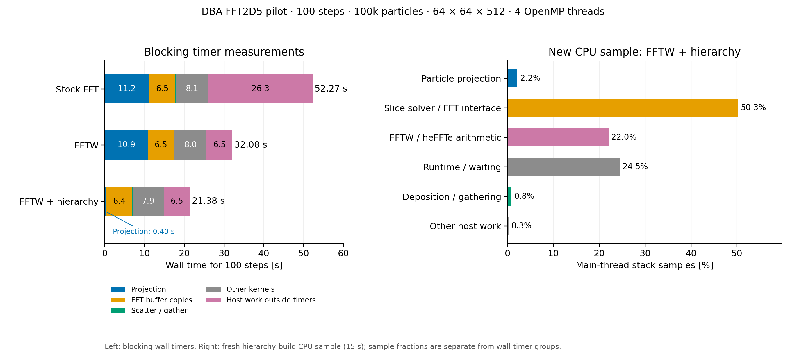
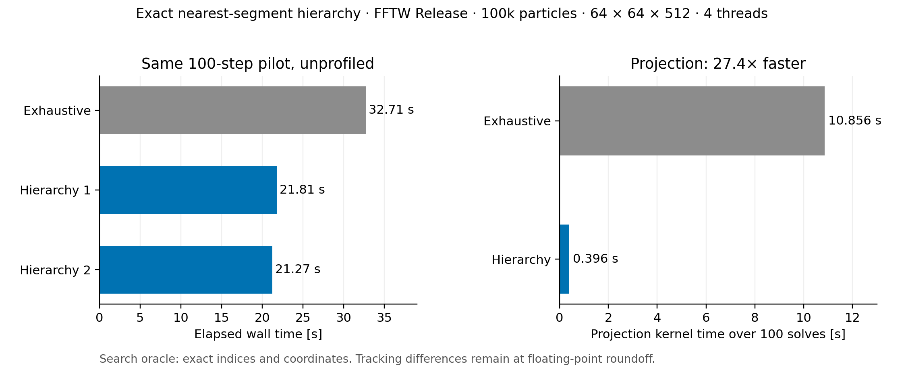

# FFT2D5 performance improvements

Same100-step DBA pilot:100,000 matched KV particles,5.602212nC,64×64×512,3ps,4OpenMPthreads/1MPIrank. Independent transverse slices; longitudinal field disabled. Release builds. This is a runtime pilot, not a ring-tune validation.

| Implementation | Unprofiled runtime |
|---|---:|
| Before projection reuse, stock FFT |73.65s|
| Reused projections, stock FFT (fresh repeat) |51.10s|
| Reused projections, FFTW3.3.11 |32.71s|
| Exact segment hierarchy, FFTW |21.27–21.81s|

Cache geometry and project particles once per solve, reusing coordinates for coverage, deposition and gather. The new hierarchy prunes segment boxes conservatively while retaining exhaustive-search scoring and first-index ties. Direct tests match segment indices and coordinates exactly. Projection kernel time falls from10.86s to0.396s with the hierarchy. Hierarchy tracking comparisons retain100,000IDs/charge and differ only at floating-point reduction roundoff (RMS/emittance relative differences≤1.22e-14).

Four unit targets pass with1and4OpenMPthreads; unsupported two-rank execution is rejected. GPU execution is untested. Conservative bounds can degrade to exhaustive work for difficult geometries.

The latest right-hand CPU sample is from the unchanged hierarchy build: slice-solver/FFTinterface50.3%,FFT arithmetic22.0%,runtime/waiting24.5%,projection2.2%. The CPU sample and wall timers are separate measurements. Three workers spend94.9% of sampled stacks in runtime/waiting. No16turnruns.

Code commits: projection reuse01bb3835ab7442c00f71cac5fb49bf77cba85661; exact searcha1ad007c8f3a761c39827ea0e06f19feefcc8f74. The measured hierarchy executable was built before the latter commit from01bb3835a plus the recorded source patch; its sources matcha1ad007c8f3a761c39827ea0e06f19feefcc8f74. FFTW is a local build dependency/configuration change, not a solver or IPPL patch. All builds use ~/git/opalx/build-omp; earlier executables are preserved.

Subdirectories contain original evidence snapshots, inputs, manifests, logs, numerical comparisons and scripts. Their filenames are dated for this catalog; `2026-11-04-source-map.json` maps the published copies to their original layouts and hashes. Historical notes retain their recording-time commit status. Scripts retain their original raw-directory assumptions; external initial particle/checkpoint assets are required. No executable or large particle dump is included. The former complete curve tracking benchmarks remain in the parent2d5-1archive.

The new catalog entries validate (paths, SHA-256 and LFS coverage). Full tracked-snapshot validation retains the pre-existing MuE4 movie catalog/path inconsistencies; this archive adds no validation failure.
