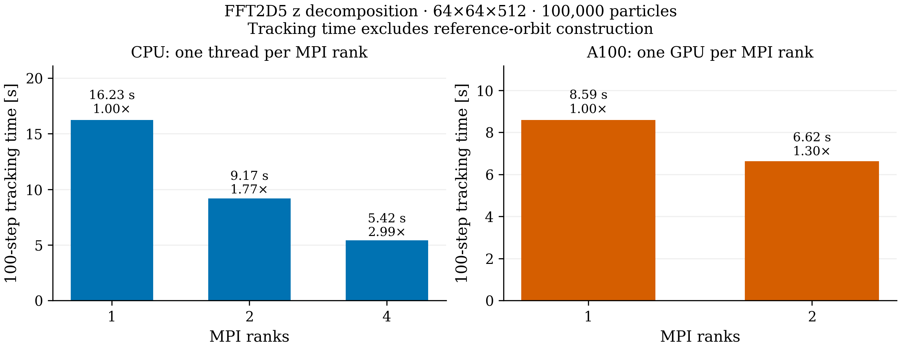
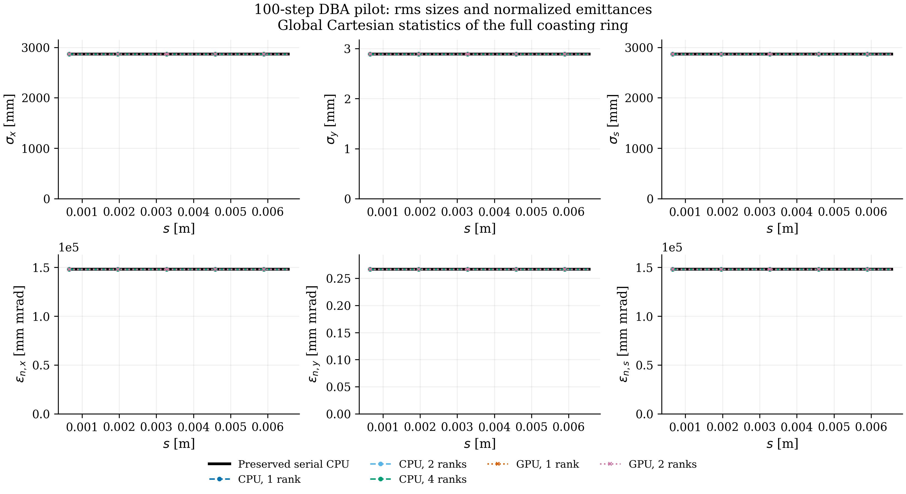

# FFT2D5 longitudinal MPI decomposition

The original FFT2D5 model now distributes complete transverse planes between MPI
ranks. Particle migration and field halo exchange use the existing OPEN/IPPL
infrastructure. OPALX performs each rank's transverse FFT batches on a private
communicator. IPPL is unchanged; no longitudinal FFT or additional field model is
introduced.

For migration, OPALX temporarily uses the projected path coordinates `(u,v,s)` as
particle positions. A registered scratch attribute carries the exact Cartesian
positions with every migrating particle. OPALX then restores those positions and
refreshes the projections, reusing the path hierarchy. Particle boundary rules are
disabled only during this bounded logical-coordinate migration and restored
immediately afterward. Density accumulation and field halos connect adjacent
slabs and the closed-ring seam. A separate reduction of the small line-density
vector supplies the existing longitudinal derivative.

## Test case

The comparison uses the same 100-step DBA pilot: 100,000 matched coasting KV
particles, 5.602212333965894 nC, a 64×64×512 grid, a 3 ps time step and batch size
64. Every run restarts from the same checkpoint. `FFT2D5MODEL="ORIGINAL"` and
`PIPEMODE="NONE"` retain the published transverse-only pilot. The input changes
only to `PARFFTX=FALSE, PARFFTY=FALSE, PARFFTZ=TRUE`. CPU ranks use one OpenMP
thread each; GPU ranks use one A100 each. Both original executables are preserved.

The separate field test checks the enabled longitudinal model. It compares the
mesh fields with direct discrete convolution using the integrated logarithmic
Green function, independently of FFT execution. Open and closed paths, both
longitudinal deposition shapes, slab interfaces, the periodic seam, exact path
endpoints, empty ranks and repeated migration are covered. The test also checks
all three particle electric and magnetic field components and restoration of
positions, momenta and IDs. It passes on 1, 2 and 4 CPU ranks and on 1 and 2 A100s.
Existing FFT2D5 algorithm, numerics and configuration tests pass with one and four
OpenMP threads and on one A100.

## Results

The CPU pilot retains all 100,000 particle IDs and the full charge. Its largest
rms-size or emittance discrepancy from the preserved executable is
1.05×10⁻¹² relative to the peak of the corresponding reference statistic.

| MPI ranks | CPU time [s] | CPU speedup | A100 time [s] | GPU speedup |
|---:|---:|---:|---:|---:|
| 1 | 16.23 | 1.00 | 8.59 | 1.00 |
| 2 | 9.17 | 1.77 | 6.62 | 1.30 |
| 4 | 5.42 | 2.99 | deferred | — |

Times are means of two repetitions of the final executable. Tracking time is the
maximum main timer minus the maximum reference-orbit construction timer; this
includes the remaining initialization and output costs. The raw
total times and repetition ranges are retained in [summary.csv](summary.csv).
The CPU one-rank range is 15.87–16.59 s. The A100 tracking ranges are 8.54–8.63 s on one GPU and
6.616–6.629 s on two GPUs. Four GPUs were deferred at the user's request.

The GPU reference-orbit construction still takes about 39 s. Consequently,
end-to-end pilot wall times change from 51.23 s to 50.13 s, despite the 1.30×
tracking speedup. The corresponding CPU wall times are 18.35, 11.11 and 7.88 s.
These timings compare the local CPU build with A100s on Merlin6.

Both GPU configurations retain all particles and charge. Across all accepted
runs, the largest rms/emittance discrepancy from the preserved CPU is
1.05×10⁻¹² relative; the largest particle-position difference is 4.87×10⁻¹² m.
The GPU-only comparison with the preserved A100 executable agrees within
8.3×10⁻¹³ relative in these statistics. See [gpu-vs-preserved.csv](gpu-vs-preserved.csv).

The size and emittance plots use global Cartesian statistics of the full coasting
ring; they do not measure the local KV cross-section. Their axes include zero.
The separate [difference plot](differences.png) resolves numerical discrepancies,
normalized by the peak value of each preserved-CPU statistic.

## Reproducibility and scope

On Merlin6, use OpenMPI's `mpirun`, not the site's default Slurm PMI2 launch
for OpenMPI 5. The supplied launcher assigns one CUDA device to each local MPI
rank. A separate MPI/CUDA probe verifies the actual communicator size and distinct
GPU UUIDs before any test or timing run. Earlier two-GPU singleton-launch attempts are
excluded from these results. The accepted GPU jobs are 355028 and 355029; the
preserved one-rank reference from 355021 remains valid.

[provenance](provenance) contains executed inputs, run manifests, logs, unit-test
results, the implementation diff and analysis drivers. [identity.json](provenance/identity.json)
records source and executable identities. Raw CPU outputs remain under
`~/git/opalx/tmp/2026-11-06-fft2d5-mpi-z`; GPU outputs remain under
`/psi/home/adelmann/opalx-dev/dba/validation-mpi-z-20261106` on Merlin6.

These are 100-step correctness and timing checks. They do not establish scaling
to 128 ranks or long-term tracking accuracy. No 16-turn run was started.
