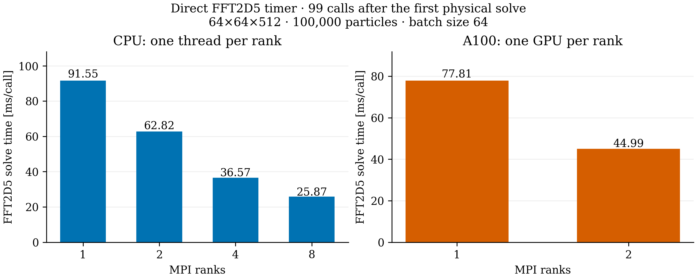

# Direct FFT2D5 timing after warmup

FFT2D5 now records its work directly in `timing.dat`, following OPEN's separation
of initialization, backend warmup, Green preparation and physical solves. The
previous `mainTimer − OrbThreader` measurement also included other tracking and
output work; it was not a solver-only time.

`2D5 Initialize` records path and storage setup. `2D5 Warmup` runs one zero-source
backend batch to prepare FFT plans, buffers and the Green spectrum without
advancing tracking or touching particles. Plan and Green timings remain visible;
zero-source FFT execution is excluded from physical phase counters. No global
timing reset erases samples from other solver instances.

`2D5 First Solve` records the first physical call. `2D5 Solve` records the following
99 calls, including frame transformations, projections, migration, deposition,
Poisson work, gathering and restored moments. All 100 physical steps remain in
the results. `2D5 Poisson` is the closest counterpart of OPEN's backend `Solve`
timer; its narrower scope includes occupancy selection, transverse solves and
field halos.

## Results

The unchanged DBA pilot uses 100,000 particles, a 64×64×512 grid, batch size 64,
5.602212333965894 nC, a 3 ps time step and 100 steps. Every case restarts from the
same checkpoint. CPU ranks use one thread each on the 18-core Apple M5 Pro;
GPU ranks use one A100 each on Merlin6. `FFT2D5MODEL="ORIGINAL"`, `PIPEMODE="NONE"`
and `PARFFTZ=TRUE` are unchanged.

The table reports the maximum accumulated rank time for `2D5 Solve`, divided by
its 99 samples. Initialization, warmup, the first physical call, OrbitThreader
and other tracking work are excluded.

| MPI ranks | CPU [ms/call] | A100 [ms/call] |
|---:|---:|---:|
| 1 | 91.55 | 77.81 |
| 2 | 62.82 | 44.99 |
| 4 | 36.57 | — |
| 8 | 25.87 | — |

On two A100s, backend warmup takes 40.2 ms, the first physical call takes
478.6 ms, and the remaining 99 calls take 4.4543 s. The two-GPU steady-state
speedup over one GPU is 1.73×. On one A100, warmup takes 163.9 ms and the first
physical call takes 109.5 ms. These are separate measurements, not discarded
simulation steps.

Full process wall time and the broader main-minus-OrbitThreader measure are
retained in [summary.csv](summary.csv). They should not be substituted for the
solver-only measurements above.

## Phase counters and validation

Phase timers record geometry/projections, migration, deposition, density and
field halos, line density, Poisson work, packing, forward/inverse FFTs, Green
multiplication, field extraction and gathering. Local Kokkos fences measure
completed CUDA work rather than submission latency; no extra MPI barrier is
introduced. Timers are inclusive, so parent and child totals must not be added.
Phase totals cover all 100 physical calls; geometry also counts post-migration
projection refresh. With `PIPEMODE=NONE`, the line-density timer records only
buffer clearing, not a longitudinal-field solve.

Every case has one initialization, one warmup, one first-solve sample, 99
steady-state solves and 100 Poisson calls. FFT phase counts exclude warmup:
800, 400, 200 and 100 batches for 1, 2, 4 and 8 ranks, respectively.
[Timers and counts](timers.csv) retain the full breakdown.

All six cases retain 100,000 unique IDs, the full charge, the expected time and
step number, and finite particle data. Rms sizes and emittances agree with the
preserved CPU result within 1.2×10⁻¹² relative; the largest position discrepancy
is 5.51×10⁻¹² m. See [physics-audit.csv](physics-audit.csv).

The CPU algorithm/numerics tests and MPI field checks pass, including four ranks
and four OpenMP threads. On GPUs, the 12 algorithm tests, including the new
warmup/counter regression, and the independent two-rank field test pass.
The CUDA numerical suite also passes (67 tests; the single-rank launch skips
one MPI-only configuration test). No numerical tolerance changed.

## Files and provenance

The new two-GPU run is on Merlin6 at
`/psi/home/adelmann/opalx-dev/dba/validation-timing-20261106/gpu-2`
(job 355031). The one-GPU run is in the adjacent `gpu-1` directory (job 355032).
Each contains `timing.dat`, the input, log, statistics, particles and run manifest.

[provenance](provenance) contains inputs, raw timer files, logs, analysis scripts
and executable/source identities. CPU runs remain under
`~/git/opalx/tmp/2026-11-06-fft2d5-timing/cpu-ranks-{1,2,4,8}`.
The previous CPU and GPU executables are preserved as
`opalx.pre-timing-20261106` next to the active executable. IPPL is unchanged.
No four-GPU or 16-turn run was started.
