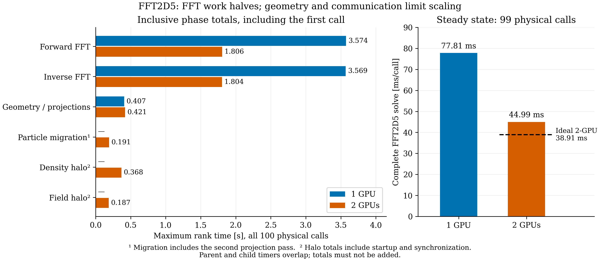

# GPU timing breakdown and next optimizations

The complete steady-state FFT2D5 call decreases from 77.8124 ms on one A100 to
44.9929 ms on two A100s: 1.729× speedup, or 86.5% parallel efficiency. Ideal
halving would give 38.9062 ms; the observed gap is 6.0867 ms per call.

The phase bars cover all 100 physical calls, including the first call. The
steady-state bars use only the remaining 99 calls. They deliberately use different
sample sets and must not be interpreted as an additive decomposition of steady
state. All values are maximum accumulated rank times.

| Timer, 100 physical calls | 1 GPU [s] | 2 GPUs [s] |
|---|---:|---:|
| Forward FFT | 3.574 | 1.806 |
| Inverse FFT | 3.569 | 1.804 |
| Geometry and projections | 0.407 | 0.421 |
| Migration, including the second projection pass | — | 0.191 |
| Density halo, including boundary kernels and synchronization | — | 0.368 |
| Field halo, including boundary kernels and synchronization | — | 0.187 |

The Poisson parent timer is 7.2935 / 3.8617 s. Packing, Green multiplication and
field extraction together take only 0.0945 / 0.0480 s. Migration contains the
second geometry call, density halo is inside scatter, and field halo is inside
Poisson. Parent and child totals overlap. A dash means there is no MPI stage;
one GPU still executes its serial boundary handling.

## What limits scaling

The FFT backend remains the largest cost, and its forward/inverse timers scale
by 1.98×. These timers include backend execution and associated overhead; they do
not isolate cuFFT arithmetic from launches, reshapes or normalization. The current
heFFTe outer batch path loops over slice executors. It batches staging in OPALX
but does not combine all independent slice planes into one cross-slice cuFFT
PlanMany execution.

Geometry does not shrink: each rank prepares the same path, including the serial
GPU prefix/bounds-tree construction. Two ranks also perform a post-migration
projection pass. These replicated operations increasingly matter as FFT work
shrinks. Migration and halo handling add work absent from the one-rank path.

Cold communication setup materially inflates the 100-call MPI totals. On rank
zero, density halo has a 245 ms maximum versus a 1.216 ms minimum; migration has
a 128.7 ms maximum versus a 0.452 ms minimum. The full first two-GPU physical
solve takes 478.6 ms. The summary statistics do not identify the sample index of
these phase maxima, so they cannot establish exact steady-state communication
costs. Network bandwidth cannot be blamed from these inclusive timers alone.

For the complete short job, OrbitThreader still takes about 39 s in either
configuration. Process wall time is 51.66 / 50.47 s. This initialization dominates
the short pilot, while the direct solver timer measures the tracking throughput.
The pilot disables longitudinal fields; it does not profile an enabled
longitudinal-field model.

## Next work within OPALX

The current CUDA build already uses IPPL → heFFTe → cuFFT. The proposed FFT
optimization concerns how independent slices are grouped into backend executions;
it is not a change from another FFT library to cuFFT. Existing heFFTe executor
and batching options should be evaluated before adding an OPALX-specific direct
cuFFT path. A direct path remains a microbenchmark candidate, not a demonstrated
requirement or speedup.

1. **Microbenchmark truly batched 2D cuFFT across slices.** Reuse the existing
   contiguous padded buffers and Green kernel, but execute a native cuFFT batch
   for all planes in a block. Retain the current backend as the reference and CPU
   path. Verify normalization, rectangular meshes, potential halos, partial
   batches and all particle fields before rerunning the pilot. This targets the
   largest component without changing IPPL or the field model. The available
   timers do not yet predict the speedup; a short Nsight trace should distinguish
   backend kernel work from host launch/reshape overhead.
2. **Remove replicated geometry preparation.** Cache rigid-path invariants such
   as segment lengths and prefixes. Parallelize required bounds updates, or
   consider a laboratory-frame hierarchy queried with transformed positions.
   Preserve nearest-segment choices and tie handling. Carry cached projections
   and segment IDs through existing particle attributes to avoid the second
   search after migration, subject to a memory/communication tradeoff.
3. **Trim OPALX boundary and synchronization overhead.** Replace full-volume
   transverse-halo clearing with a fused face-only kernel. Inspect existing
   stream dependencies and duplicated fences before changing them. Keep the
   synchronized whole-solve timer; CUDA events/Nsight can measure fine GPU phases
   without imposing a device-wide fence at every boundary. Preserve required
   producer/consumer synchronization around MPI.
4. **Separate startup cleanup from throughput improvements.** Warm zero-source
   halo exchanges to expose their setup cost in warmup. Avoid redundant serial
   FFT-plan preparation in the one-GPU batch path. These primarily affect
   initialization and first-call latency, not long-run steady-state throughput.

The first implementation candidate is the cross-slice cuFFT microbenchmark;
geometry is the clearest replicated scaling cost. No production code, IPPL file
or simulation was changed for this analysis. These two rank counts do not
establish scalability to 128 GPUs.
