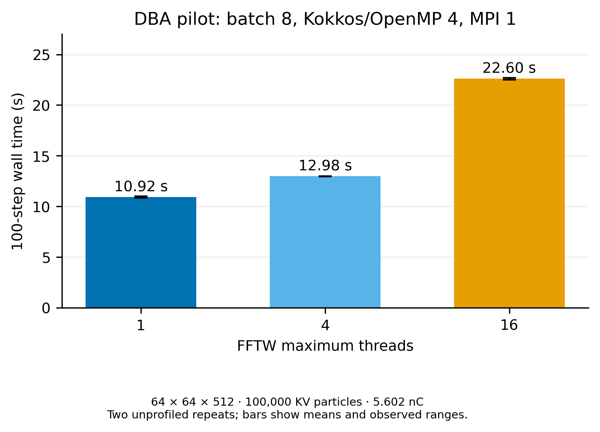
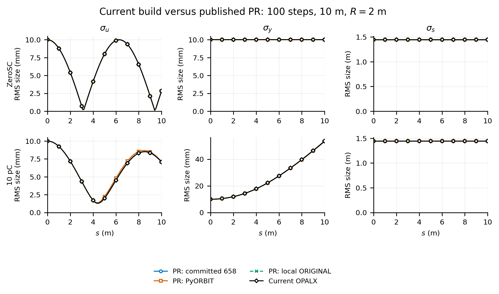
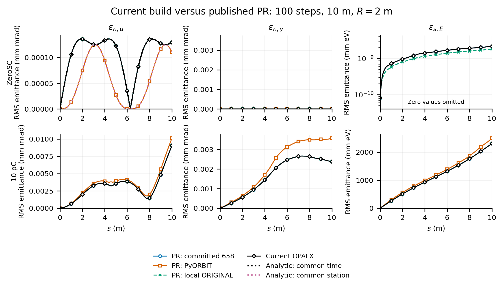
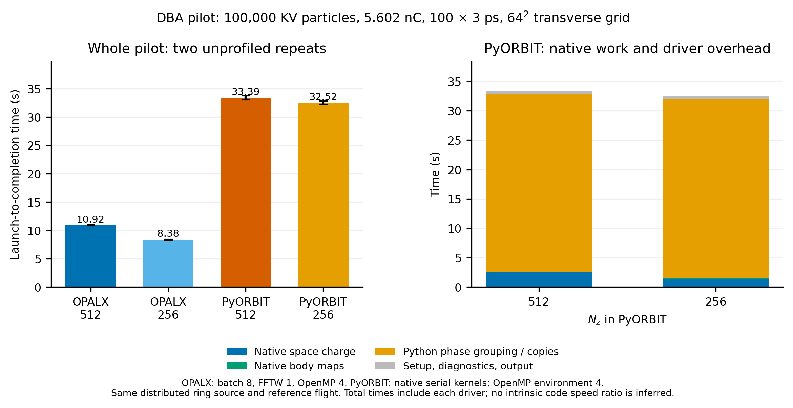
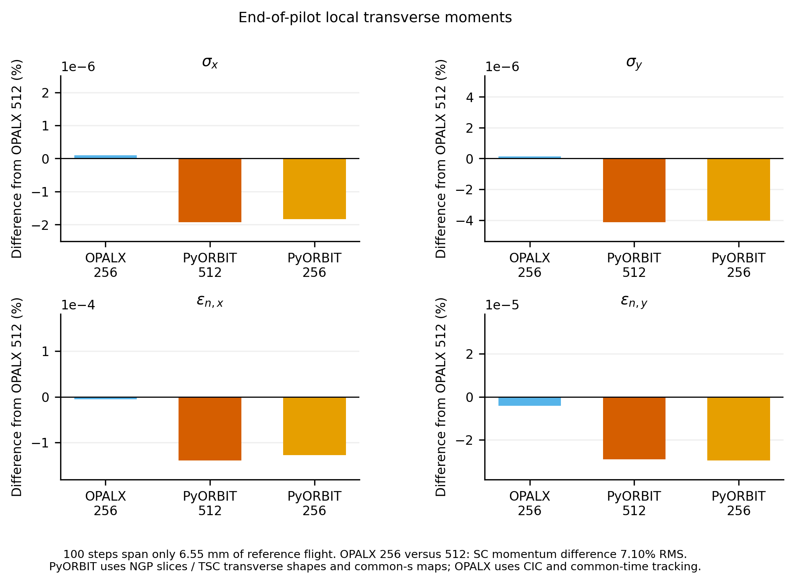

# FFTW threading, PR retention and DBA pilot comparisons

All OPALX runs use the same local Release/OpenMP/FFTW executable in
`~/git/opalx/build-omp`. The preceding executable is preserved. IPPL and
PyORBIT native code are unchanged. These changes and results are local;
no commit, push or PR edit was made.

## FFTW threading

`--2D5FFTThreads n` controls the FFTW planner maximum independently of
Kokkos. Initialization occurs once; lazy plans are primed under the requested
limit, then the previous planner setting is restored. FFTW's supported
work-loop callback sets the team size for each FFT region. A separate CPU
sample observes FFT arithmetic on all 15 workers for the 16-thread case,
while Kokkos retains four threads.

Same DBA pilot: 100,000 matched KV protons, 5.602212 nC, 64×64×512,
100 steps of 3 ps, one MPI rank, four OpenMP threads and batch size 8.
Two unprofiled repeats give:

| FFTW maximum threads | Mean wall time | Observed range |
|---|---:|---:|
| 1 | 10.92 s | 10.84–11.00 s |
| 4 | 12.98 s | 12.95–13.01 s |
| 16 | 22.60 s | 22.50–22.69 s |

One FFTW thread is fastest here. RMS/emittance differences between thread
settings are at most 1.1×10⁻¹⁴ relative. The sampled run is excluded from
these timings. Earlier constructor-only and ambient-team experiments are
excluded; their raw records remain separately labelled in the working area.

## Published PR results

The 10 m uniform-field bend benchmark was repeated at ZeroSC and 10 pC:
100 steps, 1,048,576 particles and the original 512³ charged mesh. All 200
snapshots pass ID, count, charge, time and finite-state checks. The largest
charged RMS and emittance curve differences are 8.7×10⁻¹⁰ and 2.0×10⁻⁹ of
their published peaks. ZeroSC longitudinal emittance remains at roundoff;
its absolute change is 3.54×10⁻¹³ m eV.

The analytic common-time ZeroSC endpoint error remains 0.028% for OPALX.
The unchanged PyORBIT reference has 0.025% error against the published
finite-source audit, or 0.019% against continuous-disk quadrature; its maximum
curve error remains 0.59% of the analytic peak. The separate reference
conventions are recorded in `analytic-retention.json`.

The serial and batch 1/8/32/64 DBA pilots were also repeated. Their moments
agree with the corresponding published outputs within 1.4×10⁻¹⁴ relative.
Current runtimes are 21.25/12.87/11.02/11.12/11.27 s. The historical timings
of earlier implementations retain their original provenance and were not
rerun with different executables.

## Longitudinal grid

Changing only NZ from 512 to 256 reduces mean pilot wall time from 10.92 to
8.38 s, a 23.3% reduction. Local transverse RMS sizes change by less than
1.3×10⁻⁷%; normalized emittances change by less than 5.8×10⁻⁶%.

The accumulated space-charge momentum change is more sensitive: the RMS
norm of p256−p512 is 7.10% of the RMS norm of p512−pZeroSC. The maximum
particle difference is 26.59% of the maximum 512-grid SC momentum change.
These are grid differences, not absolute errors. The pilot covers only
6.55 mm of reference flight; its small moment changes do not establish 1%
mesh convergence or long-term tune accuracy.

## PyORBIT pilot

Native PyORBIT uses the same distributed ring source, charge, reference
flight, transverse box and open transverse boundary, with longitudinal SC
disabled. Native TEAPOT body maps follow each particle's current element;
hard-edge crossings are split. Both z grids were run twice.

| Code | NZ | Mean complete pilot | Native PyORBIT SC |
|---|---:|---:|---:|
| OPALX | 512 | 10.92 s | — |
| OPALX | 256 | 8.38 s | — |
| PyORBIT | 512 | 33.39 s | 2.50 s |
| PyORBIT | 256 | 32.52 s | 1.36 s |

The PyORBIT driver spends about 30 s grouping and copying particles between
phase-dependent native body maps and the common SC bunch. These complete
pilot times include driver overhead and do not measure an intrinsic code
speed ratio. Native body maps take 0.09 s. Native PyORBIT kernels are serial;
the OpenMP environment is four for both codes.

Endpoint transverse RMS sizes and normalized emittances differ between
codes by at most 4.3×10⁻⁶% and 1.4×10⁻⁴%, respectively. This short-flight
agreement is limited evidence: PyORBIT uses NGP longitudinal slices and TSC
transverse shapes, while OPALX uses CIC; their transport samples at common s
and common time, respectively. No tune comparison is inferred.

The four relevant unit targets pass with one and four OpenMP threads. All
17 CLI checks pass; the two-rank rejection test passes on both ranks.
Doxygen reports no warnings. GPU execution and the serial-only FFTW fallback
were not exercised. No full-turn or 16-turn runs were started.

Inputs, scripts, logs, numerical tables, source patch and build/library
hashes accompany this summary. Scripts retain the original working-layout
paths recorded in the source map; external particle/checkpoint and field-map
assets are required. Large native particle dumps remain in the working
results directories and are not duplicated in this archive.
