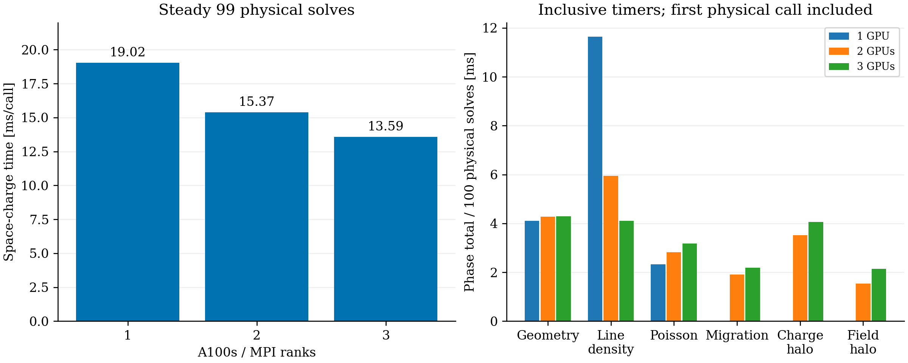
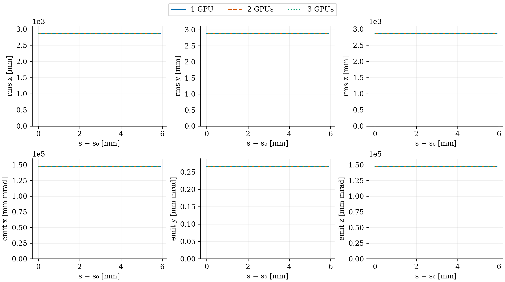

# One, two and three A100s: row-batched FFT2D5

Job 355044 completed successfully (exit 0). The probe confirmed three MPI ranks on three distinct A100s. All runs use the same validated executable `a21ab5e66c046f089d907ff14eb7b5c932a234336d49efc6b082431a8f1dd32a`, 100,000 particles, 64×64×512, batch 64, 3 ps and `PIPEMODE="OPEN"`. This comparison precedes the subsequent longitudinal-density optimization.

## Results

The three-GPU run retains all 100,000 IDs and total charge 5.602212334 nC. Final time is 0.3 ns at global step 99. Compared with one GPU, the largest RMS/emittance difference is 9.12e-13 relative; maximum particle displacement is 4.08e-12 m and momentum difference 1.13e-12 in beta-gamma units. Compared with two GPUs, the corresponding differences are 1.32e-13, 1.40e-12 m and 7.68e-13. These are floating-point-level differences. The independent direct-convolution field test also passes on three ranks, including open/closed boundaries, CIC variants and sparse sources.

| GPUs | Steady SC [ms/call] | Speedup vs one GPU | Relative parallel efficiency |
|---:|---:|---:|---:|
| 1 | 19.022 | 1.000× | 100% |
| 2 | 15.373 | 1.237× | 61.9% |
| 3 | 13.586 | 1.400× | 46.7% |

SC uses 99 physical solves after the first. The third GPU reduces SC time by 11.6%, or gives a 1.132× speedup over two GPUs. Parallel efficiency here means SC speedup divided by rank count; it is not hardware utilization.

## Timing breakdown

Each entry below is the phase total over all 100 physical solves divided by 100, in milliseconds. These phases include the first physical call. Timers are inclusive, and rank maxima may occur on different ranks: do not add the rows into a wall-time total. Initialization and warmup are separate.

| Phase | 1 GPU | 2 GPUs | 3 GPUs |
|---|---:|---:|---:|
| Geometry | 4.108 | 4.278 | 4.286 |
| Longitudinal line density | 11.641 | 5.942 | 4.110 |
| Transverse Poisson | 2.321 | 2.820 | 3.185 |
| Forward FFT, inside Poisson | 0.433 | 0.223 | 0.205 |
| Inverse FFT, inside Poisson | 0.373 | 0.192 | 0.157 |
| Particle migration | 0 | 1.904 | 2.180 |
| Charge halo | 0 | 3.513 | 4.065 |
| Field halo | 0 | 1.535 | 2.143 |

Line-density and FFT work decrease with more ranks. The replicated geometry cost remains near 4.3 ms, while halo and migration costs increase. Whole Poisson includes clearing, staging, transfers and setup beyond FFT arithmetic, and does not scale in this short-run aggregate.

Warmup takes 33.3/25.3/132.5 ms for one/two/three GPUs. The first complete physical SC solve takes 32.6/410.3/524.7 ms. These costs are excluded from the steady SC table and make short-run totals poor full-turn predictors. Rankwise maximum timers cannot be added; a large first-half-drift timer on a faster-initializing rank can include waiting for another rank to finish startup.

## Updated turn estimate

A fresh three-GPU calibration, job 355045, ran 100 and 1,000 steps in the same allocation with this same executable. All snapshot ID/charge sets and final time/step passed checks. Main-minus-reference-orbit time was 3.9392 s and 21.6131 s. Their difference over 900 extra steps gives **19.638 ms per complete step**.

At 3 ps, about 393,240 steps are required per turn:

| GPUs | Calibrated complete step | Estimated turn |
|---:|---:|---:|
| 2 | 21.482 ms | 2.347 h ≈ 2 h 21 min |
| 3 | 19.638 ms | 2.145 h ≈ 2 h 9 min |

The complete-tracking speedup is about 1.094×, or 8.6% less projected wall time. One hour still requires <9.155 ms/step, so three GPUs need another 2.15× improvement. These are short-run extrapolations from one calibration pair per rank count, not measured full turns or repeated-run uncertainty bounds. The output cadence is one particle snapshot per 100 steps. No full-turn or 16-turn run was made.

The result reinforces the existing optimization priorities: batch the line-density reductions, parallelize the hierarchy build, and reduce repeated frame/moment work. Adding one GPU does not remove those fixed and synchronization costs.

## Reproduction

Run `analyze.py` using the OPALX Python environment. `OPALX_GPU3_ROOT` selects the external cache containing `gpu-3-rows`; its sibling `calibration` directory holds `calibrate3-100` and `calibrate3-1000`. Defaults refer to `/Users/adelmann/git/opalx/tmp/2026-11-06-gpu3-analysis`. One/two-GPU native snapshots remain under `/Users/adelmann/git/opalx/tmp/2026-11-06-r2c-integration`. Inputs, logs, statistics and scripts are retained under `provenance`; no particle snapshot is stored in this report directory.

Native runs remain at `/psi/home/adelmann/opalx-dev/dba/validation-row-profile-20261106/gpu-3-rows`, `calibrate3-100` and `calibrate3-1000`. The existing executables and older one-turn reference were not overwritten for these runs.

The following RMS/emittance figure uses full-ring Cartesian statistics, not local Frenet KV emittances. Axes start at zero; all curves overlap.

