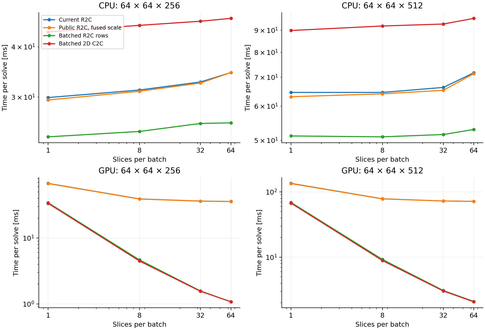

# Existing heFFTe interfaces: FFT2D5 slice microbenchmark

This experiment compares the actual `FFT2D5Poisson::solveBatched()` with existing heFFTe interfaces. It changes neither the production solver nor IPPL/heFFTe. The current CPU and GPU OPALX executables were copied before building the standalone benchmark and their SHA-256 identities checked afterwards.

## Interfaces

| Method | Existing interface | Work across slices |
|---|---|---|
| Current R2C | `fft3d_r2c::forward/backward(batch_size, ...)` | Public batch loops over per-slice executors |
| Public R2C, fused scale | Same public plan, unscaled transform | Folds forward normalization into Green multiplication |
| Batched R2C rows | `make_executor_r2c` and `make_executor` | One x-row batch across all planes, transpose, one y-row batch |
| Batched 2D C2C | `make_executor(stream, box, 0, 1)` | One merged x–y transform batched across all planes |

The factories select FFTW on the CPU and cuFFT on CUDA. Neither approach transforms z: z remains an independent slice index. These are lower-level interfaces in the pinned heFFTe headers; a production integration would need to preserve backend compatibility and plan/workspace lifetime.

Pinned dependencies: IPPL `d6216553e39dcf4405849c027517cc3401fefee5`; heFFTe `4d8d4597b479d1e4709a2b1b4cd7d8922600045f`.

## Protocol

The standalone target `BenchmarkFFT2D5Batch` links the existing OPALX library; building it does not relink `opalx_exe`. Physical grids are 64×64×256 and 64×64×512, zero-padded to 128×128 per slice. Batch sizes are 1, 8, 32 and 64. Each solve includes field clearing, source packing, forward FFT, Green multiplication, inverse FFT, electric-field extraction and potential output including transverse halos. The same synchronized phase boundaries are used as in the production implementation. Plans and buffers are reused; three warmup solves per method precede measurement. Five rounds of five solves use rotating method order. Tables report the median of the five round averages.

Before and after timing, fields and potential are compared with the actual current implementation. Rectangular 6×8 and 8×6 grids with 73 slices exercise partial batches, sparse and neutral sources, reused buffers and empty sources. All three field components and halo cells are checked, and source preservation is checked. The threshold is 1e-12 relative to the reference peak; no tolerance was relaxed.

The public `use_reorder=false` option failed multi-slice equivalence in this pinned version (batch 8: field relative error 0.96944, potential 0.93206). It is excluded for batch sizes above one, including GPU execution. Inspection suggests an inconsistent real/complex batch offset in the no-reshape branch of `heffte_compute_transform.cpp`; the dependency was not modified. Single-slice measurements of this option are retained in the CSV but excluded from the comparison figure.

CPU measurements use the laptop's FFTW backend with one OpenMP thread. GPU measurements use one MPI rank on one A100. This measures the local transverse Poisson stage, not tracking, longitudinal fields, MPI exchange or the full space-charge solve. Speedups must not be interpreted as whole-run speedups.

## Reproduction

Build only `BenchmarkFFT2D5Batch` in the existing backend build directory. Execute it from an empty results directory with `OMP_NUM_THREADS=1 OMP_PROC_BIND=false`. It writes `validation.csv` and `samples.csv`. Optional `--validate-only` performs the small-grid checks; `--quick` adds one 256-slice, batch-64 measurement. Run `analyze.py` using the OPALX Python environment to regenerate summaries and figures.

## Preserved executable identities

- CPU: `e20ed9e4fb5a6adb33497622bea58baf728242d3b2fef3b7d360038249a97803`.
- GPU: `0b76b8c56759ef72d15b657aa92891f661acee81c97a8c118eb3146dc523b1c9`.
- Copies: `.pre-heffte-batch-20261106` beside each original executable.

Remote study: `/psi/home/adelmann/opalx-dev/dba/validation-heffte-batch-20261106`. Final matched-fence job **355037** completed successfully (exit 0). Initial build 355035 exposed a CUDA constructor-lambda restriction fixed by moving Green initialization into a member helper. Exploratory job 355036 omitted the extra inner phase fence in candidates; its results remain remote in `gpu-initial-fences` and are not used here.

## Results

All retained cases passed: 104 comparisons per backend. Maximum field/potential relative differences were 2.22e-14/7.72e-16 on CPU and 1.11e-14/4.41e-16 on GPU. Source values remained unchanged.

For 64×64×512 on one A100 (milliseconds per complete transverse Poisson solve):

| Batch | Current | R2C rows | Merged C2C | R2C row speedup |
|---:|---:|---:|---:|---:|
| 1 | 134.807 | 68.909 | 67.342 | 1.96× |
| 8 | 78.325 | 9.260 | 8.913 | 8.46× |
| 32 | 72.530 | 3.094 | 3.046 | 23.44× |
| 64 | 71.608 | 2.103 | 2.078 | 34.06× |

On CPU, batch-64 R2C rows took 52.96 ms versus 71.71 ms for the current path (1.35× throughput, 26% less elapsed time); merged C2C took 95.91 ms. Fusing normalization into the convolution alone made little difference.

**Recommendation:** integrate the row-batched R2C executor path in OPALX, preserving the original public-plan path as a compatibility fallback. It retains the half-spectrum and improves both backends. Merged C2C is only about 1% faster on this GPU at batch 64 and is slower on CPU. First validate the integrated implementation with the existing CPU/GPU pilot, including potential-dependent longitudinal fields, partial/empty batches and 1/2-rank decomposition. These integration tests have not been run by this microbenchmark.

