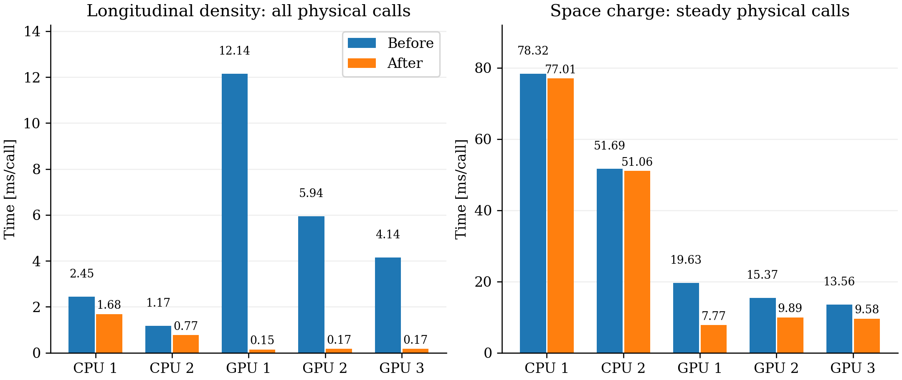
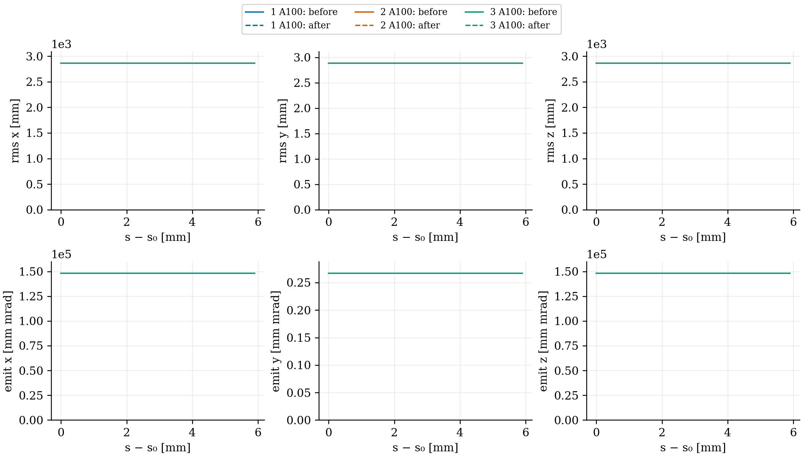

# Batched longitudinal line-density calculation

The existing longitudinal profile calculation now reduces all local transverse planes in one device launch. One team owns each local z plane; team threads traverse rows and vector lanes traverse the faster transverse dimension. The small profile is copied to the host once. The existing ordered local-to-global accumulation, MPI sum, boundary ghosts, cell-area scaling, gradient and field model remain unchanged. No IPPL change, new solver mode or longitudinal FFT is introduced.

The existing device line-density vector doubles as local scratch. Each team writes a distinct local slot, and host scratch is always independent, including on CPU backends. This preserves multiple ghost contributions that wrap to the same global slice on tiny periodic grids. Workspace remains O(number of global slices), rather than O(particles) or O(mesh volume).

## Source and executable control

The earlier GPU source directory had diverged from its validated executable: its algorithm header had reverted to an older committed version. That binary and its results were preserved. Before this comparison, the remote tracked edits were saved in a named stash and patch, colliding untracked published source files were backed up, and the checkout was fast-forwarded to the published branch commit `57f3997293fb0994267804257a825ded2b909f73`.

Both baseline and optimized builds therefore use that same source base. The only production delta is the batched density implementation and its description. The CPU baseline was rebuilt in `/Users/adelmann/git/opalx/build-omp`, and CUDA uses `/psi/home/adelmann/opalx-dev/dba/build/gwendolen-cuda`. The previous executables remain as `.pre-density-master-20261106`; the rebuilt baseline remains as `.pre-longitudinal-density-20261106`. Earlier preserved binaries and native reference runs are unchanged.

This avoids attributing the intervening master changes to the density optimization. Exact executable and input identities are retained with each run.

## Validation

The relevant CPU numerical and algorithm tests pass, including the distributed direct-convolution field check on two and three ranks. The new component test independently sums arbitrary signed, longitudinally nonuniform density on the host and compares both line density and its gradient. It covers transverse/source ghosts, open/closed boundaries, two/three-slice periodic repeated global mappings, nonzero-to-empty reuse and unchanged input density. Four-thread CPU checks also pass. Numerical tolerances are unchanged.

The tiny-grid component test initializes storage directly. It does not claim that IPPL's full halo exchange supports one-plane local slabs; that remains an infrastructure limitation. Full-solver distributed tests use supported larger slabs.

Before/after pilots use the same restarted DBA source: 100,000 protons, 5.602212334 nC, 64×64×512, dt=3 ps, batch size 64 and `PIPEMODE="OPEN"`. CPU uses one OpenMP thread per rank. CUDA uses one A100 per rank. Longer 1,000-step runs calibrate complete tracking time without scaling fixed startup costs. No full-turn or 16-turn run is started for this change. Raw particles and trace databases stay at native run/cache locations and are not placed in this report directory.

## Results

The density calculation is 83.6× faster on one A100. The CUDA trace confirms one density kernel per physical solve: 100 launches for 100 steps, compared with 51,200 previously on one GPU. The new density kernels consume 4.06 ms of GPU execution over the entire 100-step trace; the phase wall time includes allocation, transfer and host/MPI work. Raw kernel time and phase wall time are different measurements.

| Backend / ranks | Density before → after [ms/call] | Steady SC before → after [ms/call] |
|---|---:|---:|
| CPU / 1 | 2.452 → 1.684 | 78.320 → 77.012 |
| CPU / 2 | 1.167 → 0.769 | 51.686 → 51.059 |
| A100 / 1 | 12.141 → 0.145 | 19.634 → 7.774 |
| A100 / 2 | 5.942 → 0.168 | 15.366 → 9.892 |
| A100 / 3 | 4.144 → 0.167 | 13.557 → 9.580 |

Density averages all 100 physical calls; steady space-charge time excludes the first call and initialization. Timers are inclusive rank maxima and must not be added. Each configuration was measured once, so small differences do not establish repeatability.

CPU and CUDA algorithm tests pass (12 algorithm, 67 numerical, one rank-specific skip). Both parallel tests pass on two and three CPU ranks and on one, two and three GPUs. Four-thread CPU checks pass. The GPU jobs completed with exit code zero: baseline 355046, optimized 355047.

All particle IDs, charge, output times and step counts pass the independent particle audit for every 100/1,000-step GPU pair and both CPU pairs. Before/after RMS and emittance differences are below 4×10⁻¹⁴ relative. The largest endpoint position difference is 1.91×10⁻¹² m and the largest normalized-momentum difference is 3.38×10⁻¹². These are changes in reduction ordering, with no observed physical effect. This comparison checks numerical equivalence of the optimization; it adds no new validation of the longitudinal physics model.

## Complete-step turn estimate

For each rank count and executable, subtract the 100-step main-minus-OrbitThreader time from the corresponding 1,000-step time and divide by 900. At 393,240 steps per turn (dt=3 ps):

| A100s | Complete step before → after [ms] | Estimated turn before → after |
|---:|---:|---:|
| 1 | 25.033 → 13.416 | 2 h 44 min → 1 h 28 min |
| 2 | 20.756 → 14.069 | 2 h 16 min → 1 h 32 min |
| 3 | 17.783 → 14.127 | 1 h 57 min → 1 h 33 min |

One GPU is now fastest in this calibration: removing per-slice launch overhead removes the advantage of splitting those launches across GPUs. Remaining communication, geometry and frame/moment work limit scaling. The one-hour target requires 9.155 ms per complete step; the best measured configuration still needs about 1.47× further improvement. These are short-run extrapolations, not measured full turns, with no repeated-run uncertainty estimate.

The older validated executable gave approximately 2 h 9 min on three GPUs. The table above uses freshly rebuilt, matched-source baseline/optimized pairs from commit 57f399729; it must not be interpreted as a density-only comparison against that older binary.

Reproduce the tabular and plotted results with `analyze.py` in the OPALX Python environment. `OPALX_DENSITY_ROOT` selects the native/cache directory. Snapshot-free inputs, logs, statistics, audit results and run identities are under `provenance`; native locations are recorded in `provenance/native-locations.json`. The implementation is committed as `a8ce134af` in OPALX. A requested four-GPU pilot was cancelled while queued because of the account GPU limit; it produced no results.

The following curves are full-ring Cartesian statistics, rather than local Frenet KV emittances. All before/after curves overlap.

