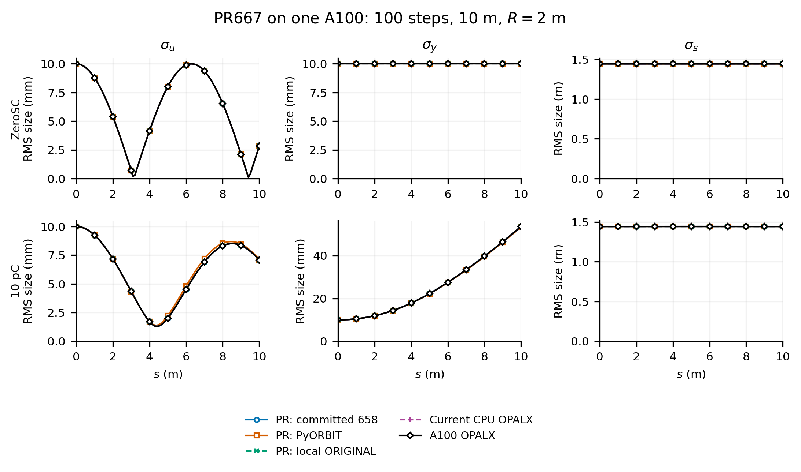
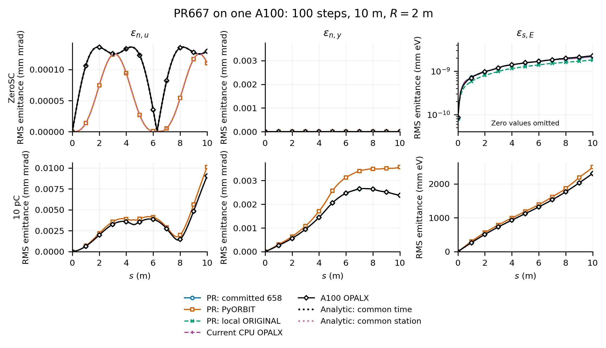
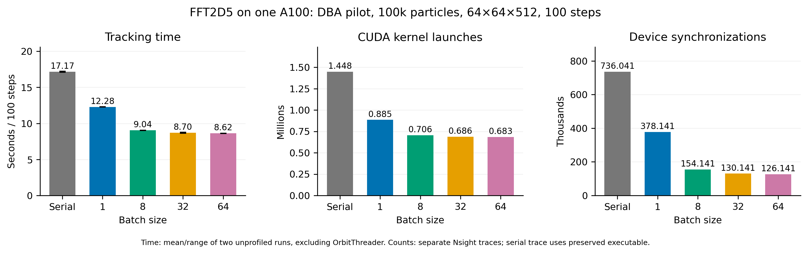

# PR667 validation and GPU batching on one A100

The PR667 branch at 6301c2cab10bf164e6d1ea60de5d0d25cdd0ca8a was built Release/CUDA AMPERE80 on Gwendolen and compared with the published CPU/PyORBIT/analytic data. Native simulations used one A100 and one MPI rank. The charged 100-step, 10 m bend repeats agree with current/published OPALX rms sizes and emittances to better than 1e-6 percent of each reference curve peak. ZeroSC longitudinal emittance is at the numerical noise floor; radial emittance retains the published common-time/common-station distinction.

## GPU batching

OPALX's existing device-memory batch path was enabled without modifying IPPL, Kokkos or heFFTe. Fences remain in place. Batch FFT stages may still execute sequentially inside heFFTe. GPU numerical batch tests pass without tolerance changes. Local OpenMP numerical/algorithm tests pass with one and four threads. The existing GPU algorithm-test null-PC launch failure remains unresolved at this checkpoint; subsequent work investigates it separately.

The unchanged DBA pilot uses 100k matched KV particles, 5.602212333965894 nC, a 64×64×512 mesh, 100 steps of 3 ps, FFT2D5MODEL=ORIGINAL and PIPEMODE=NONE. Two unprofiled repetitions per setting were followed by separate Nsight traces. Timing below excludes CPU reference-orbit tracing; it still includes other tracking work and output. Counts cover the whole native invocation. The serial trace uses the preserved original executable.

| Batch | Time excluding OrbitThreader (s) | Kernel launches | Device synchronizations |
|---|---:|---:|---:|
| Serial | 17.17 | 1,447,837 | 736,041 |
| 1 | 12.28 | 884,839 | 378,141 |
| 8 | 9.04 | 705,639 | 154,141 |
| 32 | 8.70 | 686,439 | 130,141 |
| 64 | 8.62 | 683,239 | 126,141 |

Batch 64 gives 1.99× speedup excluding initialization, 52.8% fewer launches and 82.9% fewer device synchronizations. Batch 32 is within 1%. Total wall time falls from 59.44 to 50.55 s because CPU initialization remains about 39 s. At every stat output, rms sizes/emittances agree within 1.56e-12 percent of reference peaks. Maximum endpoint component differences are 4.14e-13 m in position and 1.36e-12 in normalized momentum; charge matches exactly.

The preserved executable is `/psi/home/adelmann/opalx-dev/dba/build/gwendolen-cuda/src/opalx.pre-gpu-batching-6301c2c`, SHA256 `5457c6bd1197b5151a95e295936234e148d7263eb6d5dc99690408609334c17e`. The batch executable is SHA256 `103fa00f29f177c8fbf1b9d1cb006801631a32e6c5c5af4d004c6fc5d3ee1242`. Build job 354978 and benchmark job 354979 completed. No 16-turn runs were started.

The [evidence bundle](2026-11-05-a100-validation-evidence.tar.gz) preserves scripts, launch files, source patch, identities, per-run manifests, compact native output, comparison tables and profile summaries with their internal paths. Large particle-source assets, native HDF5 outputs and Nsight databases remain at `/psi/home/adelmann/opalx-dev/dba/validation-a100-20261105`; the bundle is not a standalone input dataset. Full kernel/API summaries distinguish summed kernel time from elapsed time and CPU API waiting.
