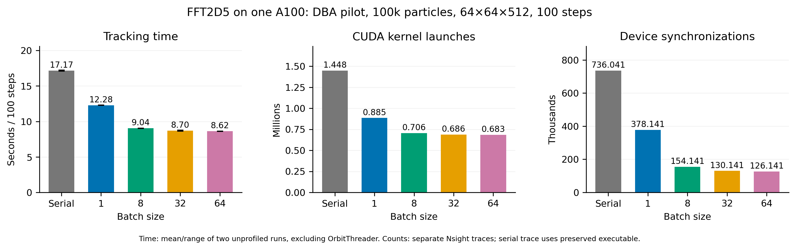

# FFT2D5 GPU slice batching

The comparison uses one A100 and one MPI rank on Gwendolen. Each run uses the same DBA lattice, restart checkpoint, 100,000 matched KV particles, 64×64×512 mesh, 100 steps of 3 ps and 5.602212333965894 nC. FFT2D5MODEL=ORIGINAL and PIPEMODE=NONE. No full-turn run was started.

The source is commit 6301c2cab10bf164e6d1ea60de5d0d25cdd0ca8a plus source.patch. The change enables OPALX's existing native-memory batching path for CUDA and enables its numerical tests. OPALX packs sources, multiplies spectra and extracts fields across each group. heFFTe chooses cuFFT for device buffers; its FFT stages can remain sequential across batch slots. Existing cross-backend fences are retained. IPPL, Kokkos and heFFTe are unchanged; hashes are in identity.json. No new field model or tolerance change was introduced.

The old executable is preserved remotely as build/gwendolen-cuda/src/opalx.pre-gpu-batching-6301c2c (SHA256 5457c6bd1197b5151a95e295936234e148d7263eb6d5dc99690408609334c17e). The current executable is built in build/gwendolen-cuda with the same Release CUDA cache. Build job 354978; measurement job 354979. Module and executable hashes are retained.

Two unprofiled repetitions are run for serial and batch sizes 1, 8, 32 and 64, reversing order for the second repetition. Report both wall time and mainTimer minus OrbitThreader. The latter still includes tracking-related bookkeeping and output, rather than timing only the field solve. Reference-orbit initialization stays serial on the CPU and dominates these short runs. Full wall time includes Slurm launch overhead. Profiles are separate invocations and are not used as performance timings. The serial kernel/API baseline is the previous preserved-executable trace, job 354971, with the same input. Counts cover the entire native invocation, including setup/output. Device synchronization counts mean cudaDeviceSynchronize calls; stream synchronization counts are separately retained in comparison.csv. Kernel durations and API waits overlap and must not be added to estimate elapsed time or utilization.

GPU TestFFT2D5Numerics passes, including batch potential halos, non-square/anisotropic meshes, partial groups, zero-net-charge sources and empty/vacated slices. Local OpenMP numerical and algorithm targets pass with one and four threads. The existing GPU TestFFT2D5Algorithm executable still has the previously observed CUDA launch failure, independently of batching. This remains unresolved and is recorded, not hidden by relaxed assertions.

Each native invocation checks executable/source/dependency/input/checkpoint identity, normal completion, IDs, particle count, charge, finite values, final step and time. Endpoint arrays are compared with the preserved serial run; rms sizes and emittances are compared over every stat output with the new serial repeat. Exact metrics and timings are in comparison.csv, moment-comparison.csv and the per-run manifests. Raw HDF5 and Nsight reports stay at /psi/home/adelmann/opalx-dev/dba/validation-a100-20261105/gpu-batching. The Python scripts reproduce the checks, tables and figure.

## Results

| Batch | Wall time (s) | Time excluding OrbitThreader (s) | CUDA kernels | Device synchronizations |
|---|---:|---:|---:|---:|
| Serial | 59.44 | 17.17 | 1,447,837 | 736,041 |
| 1 | 56.00 | 12.28 | 884,839 | 378,141 |
| 8 | 50.96 | 9.04 | 705,639 | 154,141 |
| 32 | 50.56 | 8.70 | 686,439 | 130,141 |
| 64 | 50.55 | 8.62 | 683,239 | 126,141 |

Batch 64 is fastest in this pilot (1.99× excluding initialization); batch 32 is within 1%. Batch 64 reduces kernel launches by 52.8% and device synchronizations by 82.9%. Total measured wall time falls from 59.44 s to 50.55 s because reference-orbit initialization remains about 39 s. The batch-1 second repetition has slower initialization; its tracking time remains stable. These measurements do not establish full-turn accuracy or performance.

Across all 14 native invocations, maximum endpoint component differences from the preserved reference are 4.14e-13 m for position and 1.36e-12 for normalized momentum. Charge matches exactly. Rms sizes and emittances over every stat output differ from the new serial run by at most 1.56e-12 percent of their reference peak. No tolerance was relaxed.

