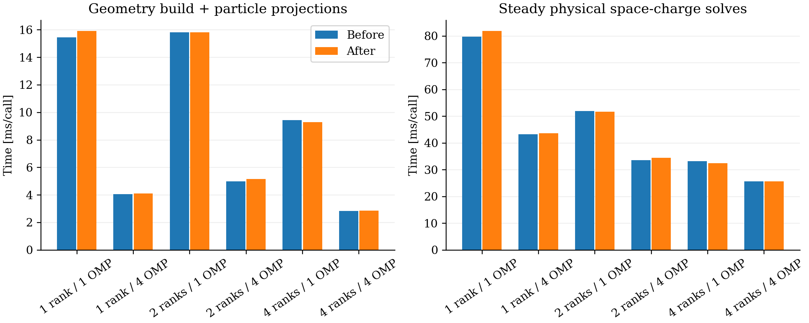

# Parallel path geometry and hierarchy: CPU validation

The existing FFT2D5 preparation function now builds independent segments and endpoint boxes in parallel. A second kernel uses one team: one thread accumulates arc lengths in the original increasing-index order, while team threads merge bounding boxes level by level with a barrier between levels. The search, segment numbering, padded leaves, conservative pruning, tie handling and projection formulas are unchanged. No parallel prefix scan, IPPL change, new file/class, solver mode or physics approximation is introduced. Production workspace is unchanged.

The build remains Release/OpenMP in `/Users/adelmann/git/opalx/build-omp`. The baseline executable is preserved as `src/opalx.pre-parallel-geometry-20261106`, SHA256 `27108289a5f7e3925a622d4273ce31c96633636de09eb45eb33c00a17b0c3839`. The optimized executable SHA256 is `e77830e07e695f84baa45db5dc5c67a1fcafdb92dc84e4cec9254a38c0853e1c`. Both use source base `a8ce134afa4e79c97e1611635e029579564ada35`; the optimized binary adds only the geometry/hierarchy change. No GPU build or run was made for this step.

## Exact component checks

The previous serial device build is retained as an independent unit-test oracle. All six segment-geometry columns, all used hierarchy nodes and padded leaves agree with strict floating-point equality, without a tolerance. The existing exhaustive nearest-segment oracle also checks winning indices and all three projected coordinates exactly. Cases include paths at the DBA segment-count scale (2,606 intervals plus a repeated vertex), self-intersections, repeated vertices/segments, ties, one-segment paths, non-power-of-two leaf counts, changing allocations/order, large translations and extreme scales, including subnormal squared lengths.

These checks pass with one and four OpenMP threads. All 12 algorithm tests and 67 numerical tests pass at both thread counts; one rank-specific numerical test is skipped on one rank. Both parallel tests pass with 1, 2 and 4 MPI ranks, each with 1 and 4 OpenMP threads. Distributed tests check migration, open/closed boundaries, density/gradient reduction, and fields against independent direct convolution.

## Tracking and timing

The same restarted 100-step DBA pilot uses 100,000 particles, 5.602212334 nC, 64×64×512, 3 ps, batch size 64, OPEN longitudinal fields and z decomposition. Before/after pairs use the same input and source checkpoint. Runs were sequential; OpenMP binding was disabled.

| MPI ranks | OMP threads/rank | Process wall before → after [s] | Steady SC before → after [ms/call] |
|---:|---:|---:|---:|
| 1 | 1 | 16.188 → 16.534 | 79.702 → 81.823 |
| 1 | 4 | 8.470 → 8.506 | 43.247 → 43.568 |
| 2 | 1 | 9.065 → 9.066 | 51.931 → 51.710 |
| 2 | 4 | 6.703 → 7.140 | 33.572 → 34.470 |
| 4 | 1 | 6.047 → 5.943 | 33.203 → 32.449 |
| 4 | 4 | 5.982 → 6.003 | 25.628 → 25.598 |

A repeat of the noisy two-rank/four-thread pair gives 6.592 → 6.501 s process wall and 32.838 → 32.915 ms per steady SC solve. The first slowdown does not persist. The CPU measurements establish no reliable overall speedup or slowdown. Most configurations have only one pair, so differences of a few percent should not be interpreted as performance changes. A short plotting/analysis pass overlapped part of the initial run sequence; the targeted repeat ran without that analysis.

The `2D5 Geometry` timer includes particle projections as well as path preparation. It is not an isolated build-kernel measurement. Process wall includes startup; SC averages the 99 steady physical solves. No full-turn timing is inferred from these short runs.

All particle IDs, charge and output times are preserved. Before/after RMS and emittance differences are below 1.9×10⁻¹⁴ relative, and endpoint positions differ by less than 4.13×10⁻¹³ m. Full tracking outputs are not bitwise identical; strict exactness is demonstrated by the component geometry/hierarchy/projection tests, while tracking agrees at floating-point roundoff. The separate repeat audit is retained alongside the six original pairs.

## Reproduction and limits

Run `analyze.py` with the OPALX Python environment. `OPALX_GEOMETRY_ROOT` selects the native run/cache directory; default `/Users/adelmann/git/opalx/tmp/2026-11-06-parallel-geometry`. Particle snapshots remain there. Snapshot-free inputs, logs, statistics, run identities, test logs and runners are in `provenance`.

This is CPU-first validation of an optimization targeting the previously serial GPU build. The subsequent [A100 validation](../parallel-geometry-gpu-2026-11-06/readme.md) reports CUDA exact checks and measured speedup separately. No GPU, full-turn or 16-turn run was started. Implementation commit: `574fcabae`.
