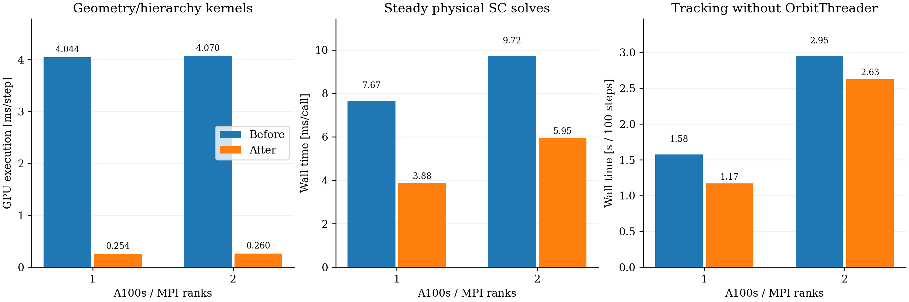
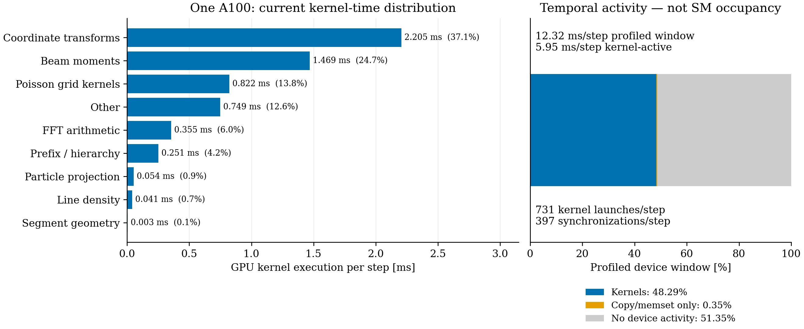

# Parallel path geometry and hierarchy: A100 validation

The geometry/hierarchy build is about 16 times faster on one and two A100s. Independent segment calculations and endpoint boxes now run in parallel. A second kernel uses one team for an ordered arc-length sum and level-wise bounding-box merges. The addition order, hierarchy topology, segment arithmetic and nearest-segment search are unchanged. No IPPL change or physics approximation is introduced.

The previous executable is preserved as `/psi/home/adelmann/opalx-dev/dba/build/gwendolen-cuda/src/opalx.pre-parallel-geometry-20261106`, SHA256 `0ce4be1d5f001fd2a4e5a1225276dc5b496c0ecd09207ba830231a1c6857fd42`. The optimized binary is preserved as `opalx.parallel-geometry-20261106`, SHA256 `981ce971edc5485c78f48525e517d8242ddbfd456e8e18ea5cf5f51ca1126c43`. Both remain alongside the active executable. The optimized build uses published source base `a8ce134af` plus the CPU-tested geometry change; the snapshot-free source patch and file hashes are retained with the results. Earlier remote density edits were saved before advancing to their committed version.

The existing CUDA build remains Release, architecture 80, in `/psi/home/adelmann/opalx-dev/dba/build/gwendolen-cuda`. Toolchain: GCC 14.3.0, Open MPI 5.0.10_slurm, CUDA 12.9.1 and CMake 4.4.0. No new dependency configuration or IPPL change was made.

## Completed comparisons

Paired before/after pilots use 100 steps, 100,000 particles, 5.602212334 nC, 64×64×512, dt=3 ps, batch 64, OPEN longitudinal fields and z decomposition. Each MPI rank uses one A100. Unprofiled runs measure wall time; separate Nsight traces measure kernel execution. Profiled process duration is not used as tracking runtime.

| A100s | Geometry build before → after [GPU ms/step] | Steady SC before → after [wall ms/call] | Process before → after [s] |
|---:|---:|---:|---:|
| 1 | 4.044 → 0.254 | 7.666 → 3.876 | 8.842 → 8.363 |
| 2 | 4.070 → 0.260 | 9.723 → 5.948 | 11.375 → 10.900 |
| 3 | Cancelled before start | — | — |

Geometry kernel time is the maximum across ranks of each rank's mean summed build-kernel execution: serial build before, segment/leaf plus prefix/hierarchy after. It excludes particle projection. SC averages the 99 steady physical solves; initialization, zero-source warmup and first solve are separate. Process wall includes launcher, checkpoint, OrbitThreader and other startup costs. The main-minus-OrbitThreader interval falls from 1.576 to 1.169 s on one GPU and 2.952 to 2.626 s on two. These 100-step pairs do not provide a fresh full-turn calibration or repeated-run uncertainty estimate.

On one A100 the two new kernels average 0.00313 ms for segments/leaves and 0.25120 ms for prefix/hierarchy. The serial ordered prefix remains in the latter kernel. Particle projection averages 0.05402 → 0.05448 ms per call. Each build kernel launches 100 times; MPI runs refresh projections after migration and therefore launch the projection kernel 200 times per rank. The geometry phase timer also includes projections, launch/synchronization overhead and preparation bookkeeping: 4.217 → 0.419 ms per physical step on one GPU, 4.345 → 0.473 ms on two. Kernel time and phase wall time must not be equated or added to inclusive parent timers.

## Updated one-turn estimate

Subtract the measured steady SC saving from the previous unprofiled 100/1,000-step complete-tracking calibration. The old executable is the same preserved density-optimized binary. At 393,240 steps per turn and dt=3 ps:

| A100s | Previous complete step [ms] | Measured SC saving [ms/step] | Updated complete step [ms] | Updated turn |
|---:|---:|---:|---:|---:|
| 1 | 13.416 | 3.790 | 9.626 | **63.1 min** |
| 2 | 14.069 | 3.775 | 10.293 | **67.5 min** |

One A100 remains fastest. The one-hour target requires 9.155 ms per complete step; the one-GPU estimate is about 5% above that budget. This is a revised extrapolation assuming unchanged non-SC tracking time, not a fresh 1,000-step calibration or completed turn. Short-pilot variation and changes outside SC are not quantified. No three-GPU estimate is made: that job was cancelled before starting. The calculation is retained in `turn-estimates.csv` and reproduced by `analyze.py`.

## Current runtime distribution: one A100

The existing optimized trace contains the required data, so no new simulation was run. The window starts at the second segment-build kernel and ends at the last GPU kernel: 99 steady solves plus final GPU bookkeeping, excluding OrbitThreader and the first physical solve. Percentages below describe GPU kernel execution, not fractions of unprofiled total wall time.

| GPU work | Kernel time per step [ms] | Share of kernel time |
|---|---:|---:|
| Coordinate transformations | 2.205 | 37.1% |
| Beam moments | 1.469 | 24.7% |
| Poisson grid kernels | 0.822 | 13.8% |
| Other | 0.749 | 12.6% |
| FFT arithmetic | 0.355 | 6.0% |
| Prefix/hierarchy | 0.251 | 4.2% |
| Particle projection | 0.054 | 0.9% |
| Line density | 0.041 | 0.7% |
| Segment geometry | 0.003 | 0.1% |

Poisson grid kernels include packing, transposes, Green multiplication and field construction. The remaining dominant targets are coordinate transformations and moments, rather than geometry or FFT arithmetic.

The profiled window is 12.32 ms per step, with 5.95 ms of kernel execution: kernels active 48.29%, copy/memset-only activity 0.35%, and no traced device activity 51.35%. These are interval-union temporal measurements, not SM occupancy or memory-bandwidth utilization. Inactive device intervals can contain host work, launch/synchronization overhead and I/O; they are not all recoverable compute time. This profiled window is not substituted for the unprofiled whole-step calibration used in the turn estimate.

There are 72,376 kernel executions and 39,260 CUDA device/stream synchronization calls in the cropped window: about **731 kernels and 397 synchronizations per step**. Host launch APIs occupy about 3.25 ms per step and synchronization APIs about 4.92 ms per step. These API durations overlap GPU execution and must not be added to kernel times or interpreted as independent wall-time savings. The 99-step window and 579 coordinate-transform launches per step also include the existing reference-path and particle operations; the trace categories do not identify which calls are redundant.

`profile_breakdown.py` extracts the summary directly from the native SQLite trace using the standard Python library; `plot_profile.py` renders the figure. Native raw traces remain external. CSV tables retain kernel names and API counts/timings for further inspection.

## Numerical checks

The CUDA algorithm suite passes all 12 tests, including exact comparisons against the previous serial device build and an independent exhaustive projection oracle. All six segment geometry columns, every used/padded bounding box, winning indices and projected coordinates match with strict floating-point equality and no tolerance. Cases include a path at the DBA segment-count scale, self-intersections, ties, repeated vertices, changed allocations, large translations and extreme/subnormal scales. All 67 numerical tests pass, with one rank-specific skip. Both distributed tests pass on one and two A100s, including direct-convolution field comparisons and longitudinal density/gradient checks. No tolerance is changed.

All particle IDs, charge, finite data, output times and step counts pass the independent native HDF5 audits. Before/after RMS and emittance differences are below 9.4×10⁻¹⁵ relative for unprofiled pilots and below 2.3×10⁻¹⁴ including profiled runs. Endpoint position differences are below 3.75×10⁻¹³ m and normalized-momentum differences below 1.81×10⁻¹². Complete tracking outputs are not bitwise identical; exactness is established for geometry/hierarchy/projection components, while full tracking agrees at reduction roundoff.

The optimized two-GPU result also agrees with one GPU: RMS/emittance differences are below 8.2×10⁻¹³ relative and endpoint positions differ by less than 3.44×10⁻¹² m. The baseline has essentially the same cross-rank differences.

## Reproduction

Jobs 355054 (build and one GPU) and 355055 (two GPUs) completed with exit code zero. Job **355056** was cancelled at the user’s request before starting; it produced no three-GPU result. No full-turn or 16-turn run is included.

Native directory: `/psi/home/adelmann/opalx-dev/dba/validation-parallel-geometry-20261106`. Local metadata/cache: `/Users/adelmann/git/opalx/tmp/2026-11-06-gpu-parallel-geometry`. Run `analyze.py` with the OPALX Python environment; `OPALX_GPU_GEOMETRY_ROOT` overrides that cache. Snapshot-free inputs, logs, statistics, run identities, test output and scripts are under `provenance`. All raw particles, Nsight reports and SQLite trace databases remain at the native location. Implementation commit: `574fcabae`.
