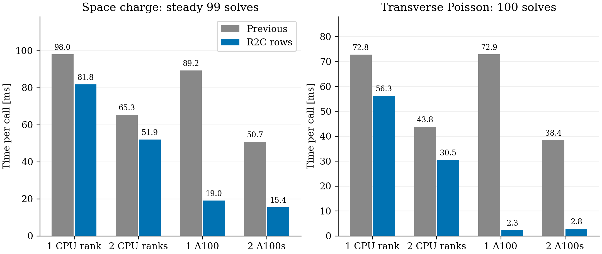
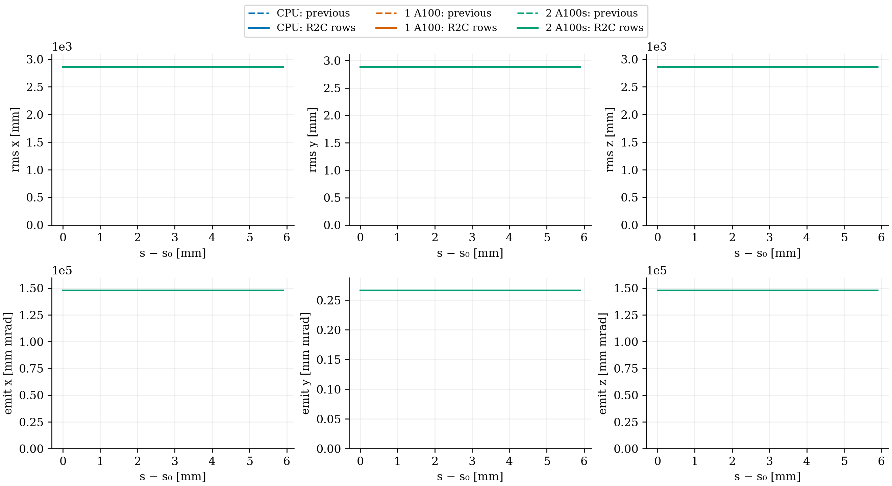
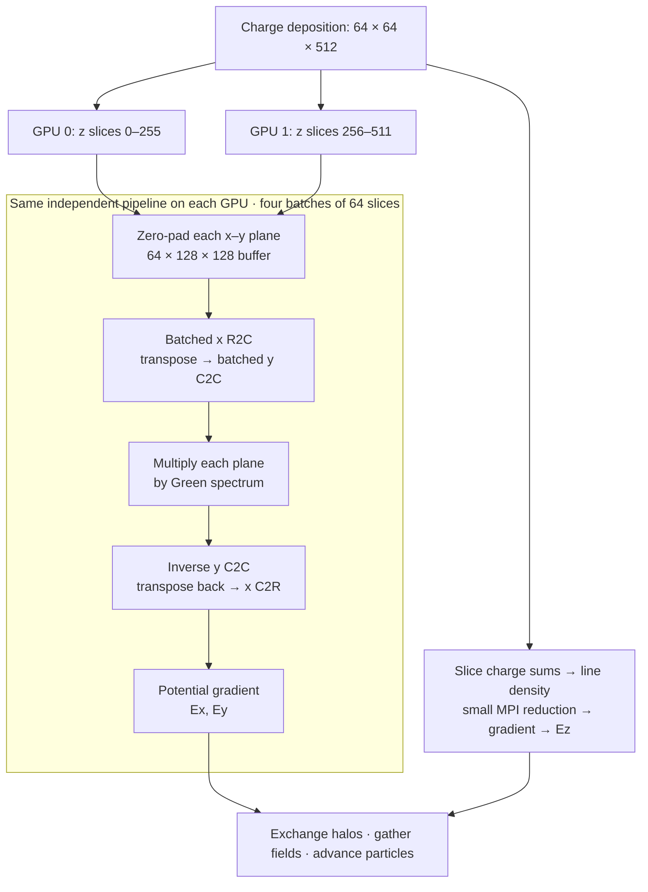

# FFT2D5 row-batched R2C integration

The transverse batch path now uses heFFTe's existing row executors. All x rows across a slice batch are transformed together; a transpose makes y columns contiguous for a second batched transform. The inverse reverses these operations. The source FFT is unscaled and its normalization is absorbed into the Green multiplication. No longitudinal FFT, new field model, IPPL change or heFFTe change is introduced.

Plans are reused for the full batch and current final remainder. Changes to grid or batch capacity invalidate the cache. Obsolete remainder plans are discarded so tracking with changing occupancy does not accumulate backend workspaces. Buffers remain in native CPU/GPU memory, using the existing synchronized phase timers. The public R2C plan remains for normalized Green initialization on MPI ranks.

## Comparison

Both the preserved executable and the integrated executable track the same restarted DBA source for 100 steps: 100,000 protons, 5.602212334 nC, 64×64×512, batch size 64, dt = 3 ps. `FFT2D5MODEL="ORIGINAL"`, closed-ring reference path and z decomposition are unchanged. **`PIPEMODE="OPEN"` enables longitudinal fields in every run.** The earlier timing pilot used `NONE`; it is not used as the timing baseline here.

CPU runs use the Release FFTW/OpenMP build in `~/git/opalx/build-omp`, one OpenMP thread per MPI rank. CUDA runs use one MPI rank per A100 in the existing Merlin6/Gwendolen build. The same checkpoint is used before and after. Individual commands, input files, executable hashes, statistics and timers are retained under `provenance`. Particle snapshots stay at their native run/cache locations, listed with checksums in `snapshot-locations.json`; they are not committed.

Timing separates initialization, warmup, first physical solve and 99 subsequent space-charge solves. The transverse Poisson timer covers all 100 physical calls. Neither warmup nor reference-path orbit generation is included in the steady space-charge average. The main-minus-orbit and process-wall values are also retained in `summary.csv`.

The RMS/emittance figure shows the same Cartesian statistics written to the stat file. For this coasting ring they describe the full ring distribution; they are not local Frenet transverse beam sizes or local KV emittances. The third Cartesian coordinate is named `s` in the stat file and labelled z in the figure. Axis origins are zero so roundoff-level fluctuations are not presented as beam evolution.

## Validation

- CPU and CUDA: 67 numerical tests passed on each backend, with one rank-inapplicable skip each; all 12 algorithm tests passed on each. The two-rank distributed direct-convolution test passed on CPU and on two distinct A100s.
- The existing batch equivalence test checks rectangular grids, neutral/sparse/empty sources, potential halos, unchanged density, full and partial batches. Its order now also exercises replacement of a changing remainder with unchanged batch capacity. No tolerance changes.
- Each pilot must retain 100,000 unique particle IDs, charge and final time/step. Statistics and final particles are compared before/after and across backends/rank counts.

The previous executables remain beside the active executables as `.pre-r2c-rows-20261106`; earlier preserved executables and reference run directories are unchanged. No 16-turn runs, commit or push were performed.

CPU preserved SHA-256: `e20ed9e4fb5a6adb33497622bea58baf728242d3b2fef3b7d360038249a97803`.
GPU preserved SHA-256: `0b76b8c56759ef72d15b657aa92891f661acee81c97a8c118eb3146dc523b1c9`.

Remote study: `/psi/home/adelmann/opalx-dev/dba/validation-r2c-rows-20261106`.

Set `OPALX_SNAPSHOT_ROOT` to a directory containing the named run subdirectories and external `case.h5` files when rerunning the particle audit. Published CSVs and figures can be read without them. Run `analyze.py` with the OPALX Python environment to regenerate the CSV tables and PDF/PNG figures from the retained run outputs. The integration patch records this task's delta from the pre-existing uncommitted MPI-z/timer implementation.

For this nearly uniform coasting source, longitudinal kicks over 100 short steps are weak. The preserved CPU executable with `OPEN` differs from its previous `NONE` result by about 4.3e-12 in particle momentum components. Thus this pilot exercises the enabled longitudinal path and checks integration equivalence; the nonuniform-source unit tests provide the direct field checks.

## Results

All eight pilots completed without errors. For each backend/rank count, the largest before/after RMS or emittance difference is 1.50e-14 relative, and the largest final particle-position difference is 3.84e-13 m. Across all backends and rank counts, RMS/emittance differences from the preserved CPU-one-rank result remain below 9.43e-13 relative. All runs retain 100,000 particles, the expected charge, 100 completed steps and final time 0.3 ns.

Steady space-charge timing (99 calls, excluding first physical solve, warmup and initialization):

| Configuration | Previous [ms/call] | R2C rows [ms/call] | Speedup |
|---|---:|---:|---:|
| 1 CPU rank | 98.01 | 81.79 | 1.20× |
| 2 CPU ranks | 65.30 | 51.92 | 1.26× |
| 1 A100 | 89.24 | 19.02 | 4.69× |
| 2 A100s | 50.71 | 15.37 | 3.30× |

The transverse Poisson stage averages 72.88→2.32 ms on one A100 and 38.37→2.82 ms on two A100s over **all 100 calls**, including the first physical call. The latter has a 29.99 ms Poisson outlier; its remaining minimum is 2.49 ms. Therefore the whole Poisson stage does not show two-GPU scaling in this short run, despite reduced FFT work. Complete steady space charge improves from 19.02 to 15.37 ms when going from one to two GPUs (1.24×). Work outside the FFTs now limits the gain. Longitudinal line-density calculation remains essentially unchanged: 11.64 ms/call on one A100 and 5.94 ms/call on two.

The first physical complete solve took 32.6 ms on one A100 and 410.3 ms on two A100s. It is excluded from the steady table; startup and first-call costs should not be inferred from steady performance.

Full process times, which include reference-orbit generation and all startup work:

| Configuration | Previous [s] | R2C rows [s] | Main minus reference-orbit generation, previous→new [s] |
|---|---:|---:|---:|
| 1 CPU rank | 18.91 | 17.31 | 16.49→14.89 |
| 2 CPU ranks | 11.33 | 10.02 | 9.37→8.02 |
| 1 A100 | 52.49 | 45.50 | 9.89→2.89 |
| 2 A100s | 50.96 | 47.34 | 7.29→3.75 |

GPU jobs 355038 (build, tests and one-GPU comparison) and 355039 (two-GPU probe, direct-field test and comparison) completed with exit code zero. The probe confirmed two MPI ranks on distinct A100 UUIDs. IPPL and heFFTe dependency working trees remain unchanged.

## One-turn projection

At dt = 3 ps, the reference period 1.17971872 microseconds requires about 393,240 steps per turn. The two-A100 steady space-charge rate, 15.3727 ms/step, gives 1.68 h/turn for space charge alone. Adding the separately timed integration, external-field and moments work gives about 2.2 h/turn; those timers have inclusive regions and are not an exact full-loop accounting. Conservatively scaling the complete 100-step main timer minus reference-orbit generation gives 4.09 h/turn, but also scales fixed startup and first-call costs. A practical planning estimate is therefore **about 3 h/turn, with a 2–4 h range**, for the tested charge, mesh, particles, timestep and output cadence. This is an extrapolation from a short pilot, not a measured turn with the new executable. No full-turn or 16-turn run was started for this integration.

## Batched solver flow

The common subgraph describes code executed independently on each GPU; it does not merge their density buffers. z is a slice index, never an FFT direction. The transverse FFTs have no cross-GPU communication; particle migration, charge/field halos and the small line-density reduction use MPI. Plans and buffers are reused across steps.
