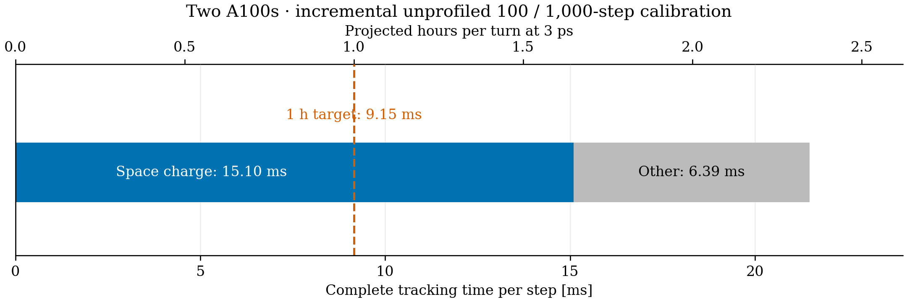
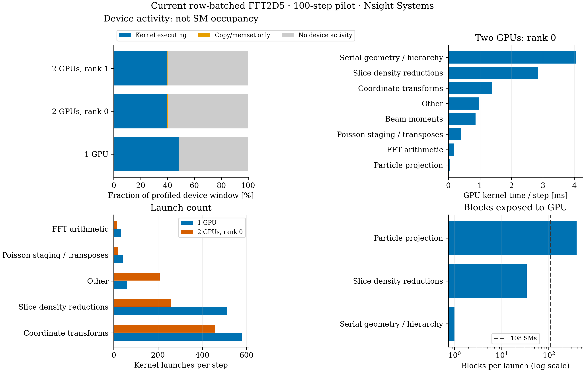

# FFT2D5 after row batching: GPU use and the one-hour target

The next gains are outside FFT arithmetic. The strongest candidates are a batched line-density reduction and removal of the single-work-item geometry/hierarchy build. Coordinate transformations and repeated beam-moment updates are the next priorities. All can be investigated within OPALX without changing IPPL or the space-charge model.

## Evidence and scope

Nsight Systems 2025.1.3 traced the same 100-step DBA pilot on one and two A100s: 100,000 protons, 5.602212334 nC, 64×64×512, dt=3 ps, batch 64, `FFT2D5MODEL="ORIGINAL"`, `PIPEMODE="OPEN"`. It uses the exact previously validated executable, SHA-256 `a21ab5e66c046f089d907ff14eb7b5c932a234336d49efc6b082431a8f1dd32a`. No rebuild or solver change was made for profiling. The later master merge on the published PR branch is not implicitly a new identity for this measured executable.

The cropped tracking window starts at the second geometry-build kernel and ends at the last GPU kernel. It covers 99 physical steps and excludes the first physical solve, initialization and roughly 40 seconds of reference-orbit generation. It is a precisely defined device window, not an unprofiled tracker timer. CUPTI tracing increases host/API cost: use the earlier unprofiled timings for speedup and turn forecasts, and these traces for counts, launch geometry and attribution.

Profiler outputs retain all 100,000 particle IDs, charge and final time. Compared with the corresponding unprofiled runs, maximum endpoint displacement is 4.15e-13 m and momentum difference 1.81e-12 in beta-gamma units. The profiling job completed successfully. No full-turn or 16-turn run was made.

## How well is the GPU used?

| Profiled window | Kernel executing | Copy/memset only | No device activity |
|---|---:|---:|---:|
| One GPU | 48.24% | 0.13% | 51.64% |
| Two GPUs, rank 0 | 39.87% | 0.57% | 59.56% |
| Two GPUs, rank 1 | 39.47% | 0.57% | 59.97% |

These percentages are unions of GPU activity intervals, not sums of overlapping events. They measure temporal activity under tracing. A running kernel need not occupy all multiprocessors; an idle interval can include required CPU or MPI work. Neither the activity percentage nor `nvidia-smi` activity establishes achieved SM occupancy or arithmetic throughput.

Hardware counters could not be collected. Nsight Systems reported the GPU metric resource as already under profiling. Both targeted Nsight Compute attempts failed with driver-resource-unavailable diagnostics, specifically warning about another collector such as DCGM. The actual competing collector was not established. No system services or unrelated processes were stopped. **Achieved occupancy, achieved bandwidth and instruction throughput remain unmeasured.** Failure evidence is retained under `provenance`.

The launch geometry is nevertheless conclusive about several limits. These A100s have 108 SMs, as recorded in the exported device metadata:

| Kernel | Grid | Block | Consequence |
|---|---:|---:|---|
| Geometry/hierarchy build | 1 block | 128 threads | Only one useful iteration (`n=0`); at most one SM participates. |
| One slice-density reduction | 34 blocks | 256 threads | At most 34 of 108 SMs can receive a block at once; then the CPU starts another slice. |
| Particle projection, two-GPU rank | 391 blocks | 128 threads | Enough blocks to spread work across all SMs; measured projection time is small. |

The first two limits are insufficient parallel work, not a shortage of GPU memory. The block counts bound available parallelism; they are not measured occupancy percentages.

## Where time and launches remain

Two-GPU rank 0, averaged over the cropped 99-step profile:

| GPU work | Kernel time per step |
|---|---:|
| Serial geometry/hierarchy | 4.06 ms |
| Slice-density reductions | 2.84 ms |
| Coordinate transformations | 1.39 ms |
| Beam moments | 0.86 ms |
| Poisson staging/transposes | 0.41 ms |
| FFT arithmetic | 0.18 ms |
| Particle projection | 0.062 ms |
| Other kernels | 0.97 ms |

This table is GPU execution time. It is not a wall-time breakdown and must not be added to host/API waits or inclusive solver timers. The unprofiled line-density phase takes 5.94 ms/call on two GPUs, including its host loop, reductions and small-vector MPI work. The unprofiled complete steady space-charge solve takes 15.37 ms/call.

The full 100-step trace contains **51,200** slice-reduction kernels on one GPU. Each two-GPU rank executes **25,800**, including its two source ghost slices. In the cropped two-GPU window, each rank has about 97,000 kernels and 102,000 explicit device/stream synchronization calls. Coordinate transformations alone account for 459 launches per step on rank 0. There are 601 full moment computations over the 100-step pilot, or roughly six per step.

MPI also remains frequent: rank 0 records 3,915 `MPI_Allreduce` calls and 3,565 `MPI_Waitall` calls in the cropped window. These are calls for all tracker/solver operations, not just the one line-density reduction. Their profiled summed API durations are 0.189 s and 0.216 s respectively; they overlap other activity and cannot be treated as separate additive wall-time fractions.

## Prioritized work without IPPL changes

1. **Reduce all local slices in one kernel.** Replace the CPU loop of scalar `parallel_reduce` calls with a team or segmented reduction over local z and x–y cells, writing a device line-density vector. Copy the small vector once and retain the existing MPI sum and longitudinal gradient. This removes hundreds of launches and scalar device-to-host synchronization points per step and exposes slices concurrently. Preserve the current pre-halo accounting: physical cells and deposited ghost weights must each contribute exactly once, including the periodic seam, neutral slices and empty ranks. The measured 5.94 ms phase is the first target; eliminating all MPI work is not required.

2. **Parallelize the geometry/hierarchy build.** The current `parallel_for(..., 1)` loops serially over segment geometry and the entire bounding hierarchy on the GPU, costing about 4 ms each step on each rank. Compute independent segment data and leaves in parallel and build independent nodes within each tree level in parallel. Retain the ordered prefix calculation where necessary to preserve existing numerical results; do not silently replace it with an associative scan. Reusing fixed-path geometry across steps may save more, but requires an explicit invariant-frame/version design because the current solve frame changes. Conservative bounds, segment tie-breaking and exception behavior must remain unchanged. Particle projection itself is already cheap; another nearest-segment algorithm is not the first priority.

3. **Fuse or avoid repeated frame transformations.** The tracker currently applies element fields through repeated bunch-frame transformations, and the solver performs its own frame transitions. Review the roughly 459 transformation launches per step before optimizing their arithmetic. Compose consecutive rigid transforms or use the existing device field-evaluation structures to evaluate supported lattice elements in one particle pass. Preserve element support, overlapping fields, source-plane losses, monitors and field-frame conventions. The global bunch must return to its expected frame at every consumer boundary.

4. **Avoid demonstrably duplicate moment updates.** `ParticleContainer::updateMoments()` performs a full calculation without checking its dirty state. The tracker updates after the first half drift, then computes beam parameters before SC; the solver updates again on restoring the frame, followed by an update after the emission path even when there is no emission. Audit these states and reuse moments only when positions, momenta, mass, particle ownership and membership are unchanged. A blanket early return based on an incompletely maintained flag would be unsafe. Removing redundant calls also reduces MPI collectives.

5. **Then reduce residual launch overhead.** Consider capture/replay of a stable GPU-only batch, or fusion of packing, transpose-compatible Green multiplication and extraction after plans are warm. Dynamic occupancy, remainders and MPI are capture boundaries. CUDA graphs cannot directly remove the current host slice-reduction loop or the serial geometry calculation. Further FFT-library tuning is lower priority: current FFT arithmetic is about 0.18 GPU-ms/step in this trace.

For each change, require the existing serial/distributed field tests and a matched before/after pilot, including nonuniform longitudinal sources, ghost/seam accounting, empty ranks, partial batches and geometry/frame changes. Keep tolerances unchanged. Measure unprofiled complete tracking time as well as GPU kernel time; fewer launches alone do not establish a speedup.

## Below one hour per turn

At 3 ps there are about 393,240 steps per turn. One hour requires **less than 9.155 ms per complete tracking step**, not merely per Poisson or SC call. Current SC alone projects to 1.68 h/turn. Thus faster FFTs alone cannot meet the target.

A fresh unprofiled calibration ran 100 and 1,000 steps in the same two-GPU allocation, with identical executable, mesh, charge and timestep. Subtracting reference-orbit generation from each main timer gives:

| Steps | Main minus orbit generation | Steady SC per call |
|---:|---:|---:|
| 100 | 3.9246 s | 15.3768 ms |
| 1,000 | 23.2585 s | 15.1240 ms |

The difference over 900 extra steps gives **21.4821 ms per complete step**, or **2.3466 h/turn (about 2 h 21 min)**. The corresponding incremental SC contribution is 15.0962 ms/step, leaving 6.3859 ms/step outside SC. This replaces the earlier rough 2–4 h planning range. It is still an extrapolation, based on one pair without a measured repeat uncertainty; full-turn evolution or changing load balance may change it. The output cadence is the pilot's cadence: one particle snapshot per 100 steps. The 1,000-step calibration retains ten valid snapshots, 100,000 particles and charge throughout, and ends at 3 ns. No snapshot is committed.

Reaching one hour therefore requires another **2.35× improvement in complete tracking**, saving about 12.33 ms/step. The 1,000-step phase averages are about 5.86 ms for line density and 4.07 ms for geometry. Even ideal removal of both leaves roughly 11.55 ms/step (about 1.26 h/turn). They are necessary targets, but are not sufficient by themselves.

A useful engineering budget is line density below roughly 0.5 ms and geometry below roughly 1 ms, followed by fewer frame transformations and moment updates. These are targets, not demonstrated timings. Meeting the first two targets would leave roughly 6–7 ms for SC, but the tracker currently adds another 6.39 ms. About 3–4 ms more must then come out of transforms, moments, synchronization or other tracker work to meet 9.155 ms overall. This is why the recommendation includes the full tracking path rather than another FFT optimization.

More GPUs alone are unlikely to solve the fixed-work problem. The current one-to-two-GPU steady SC speedup is only 1.24×, and the serial hierarchy is replicated on each rank. The measurements do not justify extrapolating to 128 ranks.

A 4 ps timestep would reduce the count to about 294,930 steps/turn and raise the one-hour budget to 12.21 ms/step. Existing ZeroSC tune studies make it a candidate, but charged-beam tune shifts and stability must be checked before changing it. Reducing mesh resolution or particle count also needs physics convergence evidence; no such reduction is assumed here.

## Reproduction and retained data

Raw traces, snapshots and failed hardware-counter attempts remain in `/psi/home/adelmann/opalx-dev/dba/validation-row-profile-20261106`. The local trace/snapshot cache is `/Users/adelmann/git/opalx/tmp/2026-11-06-publish-profile`. Set `OPALX_PROFILE_ROOT` to the corresponding cache tree when running `analyze.py`. CSV summaries and figures do not require native snapshots to view. No trace database, executable or particle snapshot is committed.

Unprofiled calibration job 355043 completed successfully; all snapshot IDs, charge and final times passed checks. Nsight Systems job 355041 completed successfully. Initial hardware-metric attempt 355040 failed before tracking. Targeted hardware-counter job 355042 completed its wrapper, but both instrumented applications returned code 9; those are failed counter measurements, not valid occupancy results. Scripts and diagnostics record this distinction.

