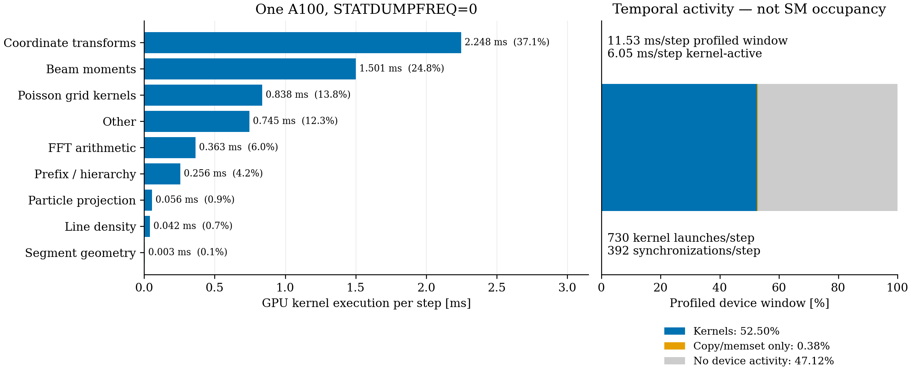

# Disable statistical output: one-A100 pilot

`STATDUMPFREQ=0` disables statistical writes, but does not remove full beam-moment calculations in this pilot. Both settings perform **601** full calculations: one initialization and six per step over 100 steps. Calls that find the moments cache clean return before starting the `computeMoments` timer, so 601 counts actual recomputations, not every request for moments.

## Where the six calculations occur

| Per step | State requiring fresh moments |
|---:|---|
| 1 | After the first half drift |
| 1 | FFT2D5 deposition in the aligned solve frame |
| 1 | After restoring the tracker frame |
| 1 | After the emission-frame round trip |
| 1 | After the kick and second half drift |
| 1 | Forced recomputation for the default 10σ outlier check |

The emission routine transforms particles into and out of the source frame even for this restarted, non-emitting bunch; those transformations mark moments dirty. The outlier check explicitly invalidates the cache before computing its bounds. The end-of-step `dumpStats()` call then finds a clean cache and contributes no additional full calculation. Merely noticing its unconditional `updateMoments()` call does not account for the measured cost.

## Controlled comparison

Job **355057** completed with exit code zero on one A100. The executable is unchanged: SHA256 `981ce971edc5485c78f48525e517d8242ddbfd456e8e18ea5cf5f51ca1126c43`, the preserved parallel-geometry build. There was no rebuild. Both inputs use the same checkpoint, 100,000 particles, 5.602212334 nC, 64×64×512, 100 steps, 3 ps, OPEN longitudinal fields and batch 64. The only input change is `STATDUMPFREQ=10` to `STATDUMPFREQ=0`. `PSDUMPFREQ=100` remains enabled for the independent final-particle audit.

| Measurement | Frequency 10 | Frequency 0 |
|---|---:|---:|
| Statistical writes | 10 | 0 |
| Full moment calculations | 601 | 601 |
| Moment time / 100 physical steps | 216.348 ms | 216.262 ms |
| Steady SC time / call | 3.948 ms | 3.959 ms |
| Process wall time | 9.579 s | 8.312 s |

There is no meaningful steady-SC or moment-time improvement. Startup-inclusive process time differs, mainly through initialization/warmup and I/O: zero-source warmup is 193.621 versus 25.347 ms, initialization 27.664 versus 11.949 ms, and HDF5 step time 81.006 versus 54.905 ms. Statistical writing itself costs 6.539 ms for all ten writes. The process-time difference must not be attributed to eliminating moment work. Only one unprofiled pair was measured; no new turn estimate or 1,000-step calibration is inferred.

All 100,000 IDs, charge, finite data, final time and step count pass independent HDF5 checks. Frequency-zero endpoint positions agree within 4.19×10⁻¹³ m and momenta within 1.80×10⁻¹² of the frequency-ten run, including the profiled case.

## Same runtime-breakdown figure

A separate frequency-zero trace uses the same crop definition as the prior figure: second geometry-build launch through the last GPU kernel, covering 99 steady solves and final GPU bookkeeping. It is compared with the existing frequency-ten trace from the same executable. Beam-moment kernel count is unchanged at **1,483** in each window. Coordinate-transform kernel count is also unchanged at **57,318**. The other category loses 120 kernels. The distribution remains dominated by coordinate transforms (~37%) and moments (~25%).

The frequency-zero profiled window averages 11.53 ms per step, with 6.05 ms kernel execution. Device temporal activity is 52.50% kernels, 0.38% copy/memset-only and 47.12% no traced device activity. These are not achieved SM occupancy measurements. Profiling overhead and host scheduling affect these fractions; they do not establish unprofiled speedup. Kernel/API timings and counts are retained in the CSV files, and API durations overlap device execution.

Native runs and raw traces remain at `/psi/home/adelmann/opalx-dev/dba/validation-stat0-20261106`; no raw particles or trace databases are included here. Local metadata cache: `/Users/adelmann/git/opalx/tmp/2026-11-06-stat0`. Reproduce with `plot_profile.py` followed by `analyze.py` in the OPALX Python environment. `OPALX_GPU_GEOMETRY_ROOT` selects the profile cache for the plot and `OPALX_STAT0_ROOT` selects the timing cache. The extractor script is retained under `provenance` and reads the native SQLite trace. No source code, IPPL, full-turn or 16-turn change was made.
