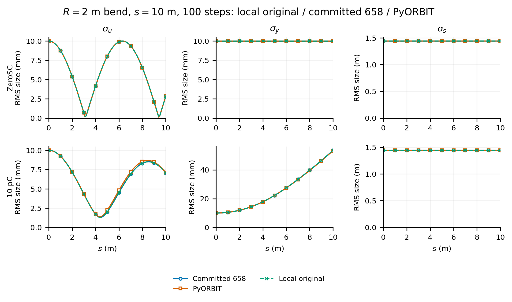
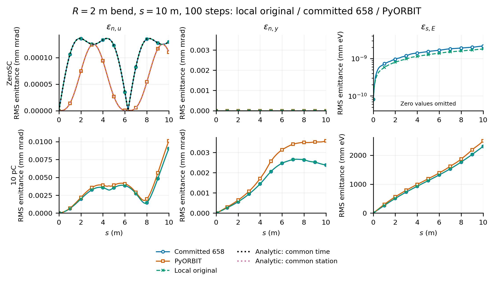
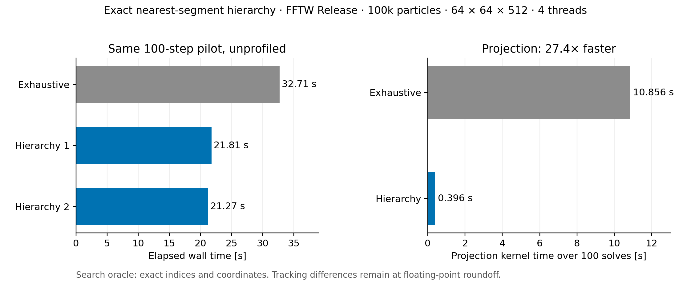
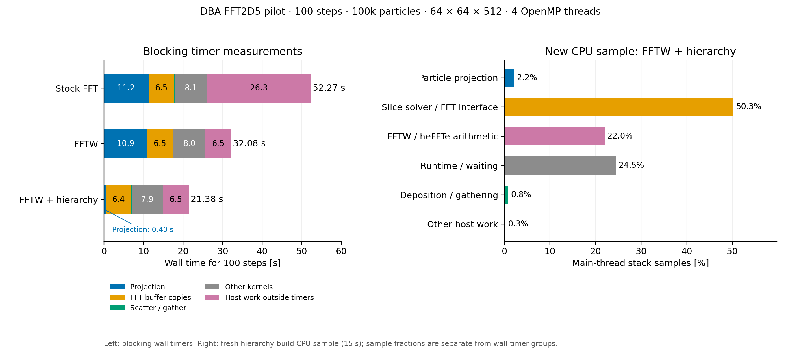

Makes `FFT2D5MODEL="ORIGINAL"` explicit and restores the solver fixes used to reproduce the published bend benchmark:

- Map particles and the fixed laboratory reference path into the same solve frame; restore particle coordinates and moments after solving or an exception.
- Use the rectangular-cell averaged logarithmic Green function, including its finite self term, and retain the convolution potential halo for centered field differences.
- Reuse one 2D FFT workspace and skip empty slices while clearing their fields. Neutral slices with nonzero charge density remain active.
- Precompute path geometry and project each particle once per solve; reuse the coordinates for coverage, deposition and gathering.
- Accelerate the global nearest-segment search with a per-solve bounding-box hierarchy. Conservative pruning, unchanged segment scoring and lowest-index ties preserve exhaustive-search results; a previous segment only seeds the bound.

`ORIGINAL` remains the default and only supported model in this PR: independent transverse 2D slices with a local longitudinal closure (`g=6.36` for `PIPEMODE=OPEN`). `PIPEMODE` selects the longitudinal approximation separately. The earlier local `FINITE_SOURCE` model, 3D operators and curvature-correction operators are outside this change.

**Validation:** the normal `TestSpaceChargeConfig`, `TestFFT2D5Algorithm`, `TestFFT2D5Numerics` and `TestPoissonSolver` CTest targets pass with one and four OpenMP threads. Tests cover frame invariance, repeated solves, independent cell-potential quadrature, Gaussian mesh convergence, length-unit scaling and boundary fields. See [unit-test details](https://github.com/OPALX-project/OPALX/blob/a1ad007c8f3a761c39827ea0e06f19feefcc8f74/unit_tests/SpaceCharge/README.md).

**Test case:** cold protons (β=0.001), a 5 m uniform round bunch with transverse RMS 10 mm, ZeroSC or 10 pC. A uniform vertical magnetic field gives R=2 m. Track 10 m in 100 steps using 1,048,576 common particles and a 512³ charged mesh; compare RMS sizes and emittances with committed 658, PyORBIT and the analytic ZeroSC radial reference.

**Analytic ZeroSC calculation:** exact circular trajectories in the uniform magnetic field give the mean-subtracted radial position–momentum covariance. Moments are integrated over the initial uniform disk, including its curved-volume Jacobian. OPALX samples at common time; PyORBIT samples in s. The plots show the corresponding separate analytic references. Endpoint radial-emittance errors are 0.028% for OPALX and 0.025% for PyORBIT; PyORBIT's maximum absolute curve error is 0.59% of the analytic peak.

Artifacts are stored in [opalx-documents/examples/2026/2d5-1](https://github.com/OPALX-project/opalx-documents/tree/691d1480bcb27275b8d6b913dd77851f498cb47b/examples/2026/2d5-1).

**100-step, 10 pC inputs:** [OPALX](https://github.com/OPALX-project/opalx-documents/blob/691d1480bcb27275b8d6b913dd77851f498cb47b/examples/2026/2d5-1/inputs/opalx-10pc-100steps.in) · [PyORBIT](https://github.com/OPALX-project/opalx-documents/blob/691d1480bcb27275b8d6b913dd77851f498cb47b/examples/2026/2d5-1/inputs/pyorbit-10pc-100steps.py). [Dependencies and provenance](https://github.com/OPALX-project/opalx-documents/blob/691d1480bcb27275b8d6b913dd77851f498cb47b/examples/2026/2d5-1/inputs/readme.md); external particle and field-map assets are required.

**Performance — same 100-step DBA pilot:** 100,000 matched KV particles, 5.602 nC, 64×64×512 mesh, 3 ps steps, 4 OpenMP threads and one MPI rank. The reference path has 2,606 segments. Use the original transverse slice model with the longitudinal field disabled; all builds are Release.

| Implementation | Elapsed time |
|---|---:|
| Before projection reuse, stock FFT | 73.65 s |
| Reused projections, stock FFT | 51.10 s |
| Reused projections, FFTW 3.3.11 | 32.71 s |
| Exact segment hierarchy, FFTW | 21.27–21.81 s |

The hierarchy reduces projection-kernel time from 10.86 s to 0.396 s (27.4×). Direct tests compare segment indices and all three coordinates **exactly** against an independent exhaustive scan over 43,540 entries, including ties, intersections, repeated vertices, stale seeds, allocation changes and extreme coordinate scales. Hierarchy tracking retains all particles and charge; RMS/emittance differences from the exhaustive FFTW run are ≤1.3×10⁻¹⁴ relative. Full tracking outputs agree at floating-point reduction roundoff, rather than bit-for-bit.

FFTW is a measured local dependency/build configuration, **not an IPPL change in this PR**. The latest CPU sample puts projection at 2.2% and slice-solver/FFT interface work at 50.3%; batching and FFT-buffer-transfer changes are not included. These are laptop timing pilots, not full-turn tune validation. No 16-turn runs were made. FFT2D5 remains single-rank; GPU execution of the new search is untested. Overlapping boxes or conservative roundoff bounds can retain exhaustive-search cost.

[Performance evidence: inputs, provenance, tests and profiles](https://github.com/OPALX-project/opalx-documents/blob/ce71b018d466eb69d8a247e408b2e2e75194f654/examples/2026/2d5-1/dba-solver-performance-2026-11-04/2026-11-04-readme.md).

Refs #658.
