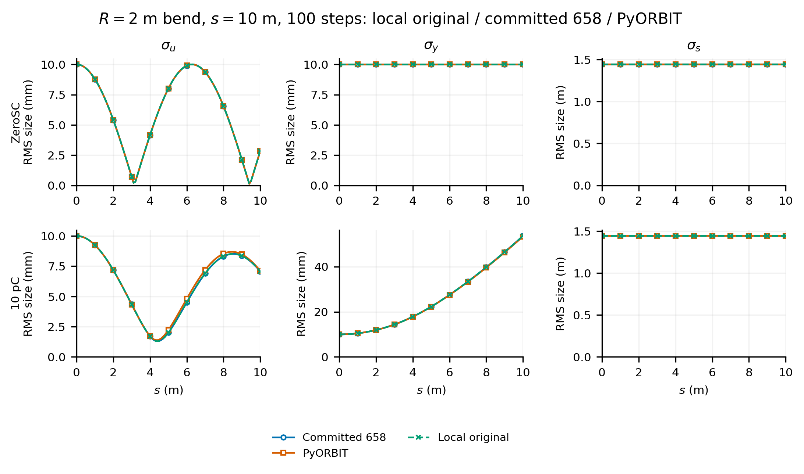
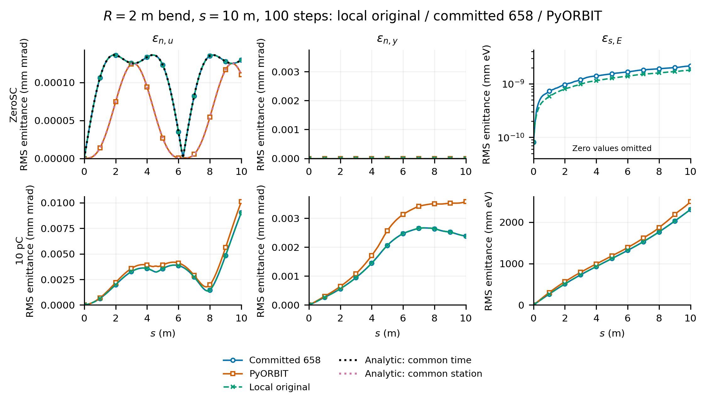
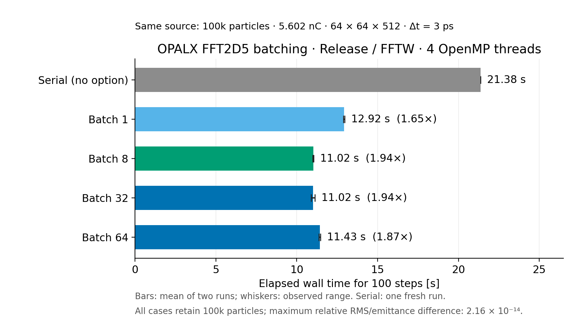
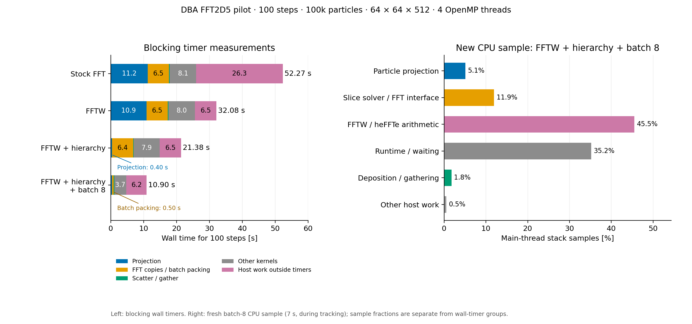
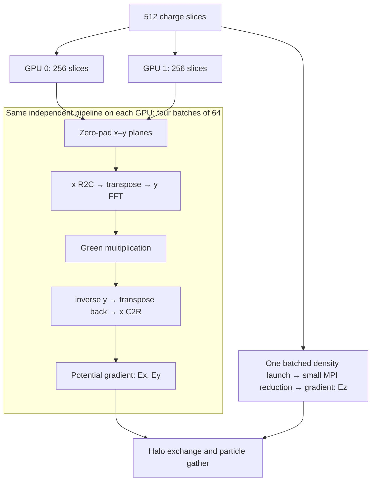
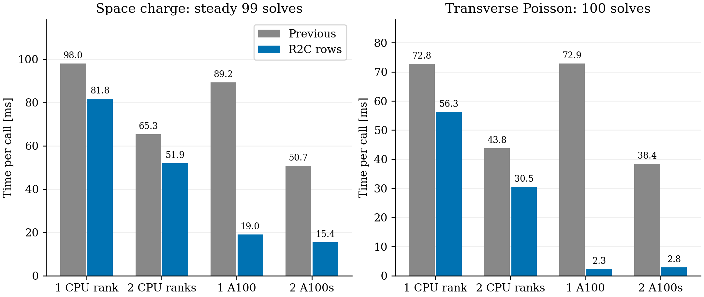
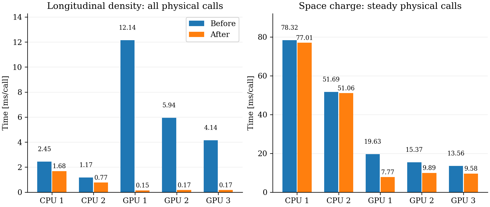
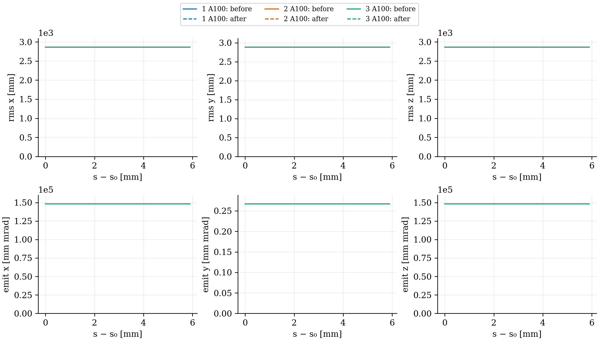

Makes `FFT2D5MODEL="ORIGINAL"` explicit and restores the solver fixes used to reproduce the published bend benchmark:

- Map particles and the fixed laboratory reference path into the same solve frame; restore particle coordinates and moments after solving or an exception.
- Use the rectangular-cell averaged logarithmic Green function, including its finite self term, and retain the convolution potential halo for centered field differences.
- Reuse one 2D FFT workspace and skip empty slices while clearing their fields. Neutral slices with nonzero charge density remain active.
- Precompute path geometry and project each particle once per solve; reuse the coordinates for coverage, deposition and gathering.
- Accelerate the global nearest-segment search with a per-solve bounding-box hierarchy. Conservative pruning, unchanged segment scoring and lowest-index ties preserve exhaustive-search results; a previous segment only seeds the bound.
- Add opt-in `--2D5BatchSize n`: pack independent transverse slices into contiguous buffers and use existing native heFFTe row executors across slices. Preserve the Green function, normalization and potential halos; no IPPL changes or longitudinal FFT.
- Reduce all local longitudinal-density slices in one team launch and one small host transfer; preserve ghost accumulation, MPI summation and the longitudinal model.
- CPU and A100 validation is described below.

`ORIGINAL` remains the default and only supported model in this PR: independent transverse 2D slices with a local longitudinal closure (`g=6.36` for `PIPEMODE=OPEN`). `PIPEMODE` selects the longitudinal approximation separately. The earlier local `FINITE_SOURCE` model, 3D operators and curvature-correction operators are outside this change.

**Validation:** the normal `TestSpaceChargeConfig`, `TestFFT2D5Algorithm`, `TestFFT2D5Numerics` and `TestPoissonSolver` CTest targets pass with one and four OpenMP threads. Tests cover frame invariance, repeated solves, independent cell-potential quadrature, Gaussian mesh convergence, length-unit scaling and boundary fields. See [unit-test details](https://github.com/OPALX-project/OPALX/blob/a8ce134af/unit_tests/SpaceCharge/README.md).

**Test case:** cold protons (β=0.001), a 5 m uniform round bunch with transverse RMS 10 mm, ZeroSC or 10 pC. A uniform vertical magnetic field gives R=2 m. Track 10 m in 100 steps using 1,048,576 common particles and a 512³ charged mesh; compare RMS sizes and emittances with committed 658, PyORBIT and the analytic ZeroSC radial reference.

**Analytic ZeroSC calculation:** exact circular trajectories in the uniform magnetic field give the mean-subtracted radial position–momentum covariance. Moments are integrated over the initial uniform disk, including its curved-volume Jacobian. OPALX samples at common time; PyORBIT samples in s. The plots show the corresponding separate analytic references. Endpoint radial-emittance errors are 0.028% for OPALX and 0.025% for PyORBIT; PyORBIT's maximum absolute curve error is 0.59% of the analytic peak.

Artifacts are stored in [opalx-documents/examples/2026/2d5-1](https://github.com/OPALX-project/opalx-documents/tree/691d1480bcb27275b8d6b913dd77851f498cb47b/examples/2026/2d5-1).

**100-step, 10 pC inputs:** [OPALX](https://github.com/OPALX-project/opalx-documents/blob/691d1480bcb27275b8d6b913dd77851f498cb47b/examples/2026/2d5-1/inputs/opalx-10pc-100steps.in) · [PyORBIT](https://github.com/OPALX-project/opalx-documents/blob/691d1480bcb27275b8d6b913dd77851f498cb47b/examples/2026/2d5-1/inputs/pyorbit-10pc-100steps.py). [Dependencies and provenance](https://github.com/OPALX-project/opalx-documents/blob/691d1480bcb27275b8d6b913dd77851f498cb47b/examples/2026/2d5-1/inputs/readme.md); external particle and field-map assets are required.

**Performance — same 100-step DBA pilot:** 100,000 matched KV particles, 5.602 nC, 64×64×512 mesh, 3 ps steps, 4 OpenMP threads and one MPI rank. The reference path has 2,606 segments. Use the original transverse slice model with the longitudinal field disabled; all builds are Release.

| Implementation | Elapsed time |
|---|---:|
| Before projection reuse, stock FFT | 73.65 s |
| Reused projections, stock FFT | 51.10 s |
| Reused projections, FFTW 3.3.11 | 32.71 s |
| Exact segment hierarchy, FFTW | 21.27–21.81 s |
| Hierarchy + slice batching (8 or 32), FFTW | **11.02 s** |

The hierarchy reduces projection-kernel time from 10.86 s to 0.396 s (27.4×). Direct tests compare segment indices and all three coordinates **exactly** against an independent exhaustive scan over 43,540 entries, including ties, intersections, repeated vertices, stale seeds, allocation changes and extreme coordinate scales. Hierarchy tracking retains all particles and charge; RMS/emittance differences from the exhaustive FFTW run are ≤1.3×10⁻¹⁴ relative. Full tracking outputs agree at floating-point reduction roundoff, rather than bit-for-bit.

**Slice batching:** `--2D5BatchSize 8` is opt-in; serial remains the default. In the same-executable comparison, batching reduces 21.38 s to about 11.02 s. Sizes 8 and 32 are effectively tied; 8 uses one-quarter the real/spectral buffer memory. With 16 OpenMP threads, batch 8 averaged 12.38 s, slower than with four threads.

New tests compare potential/halo and fields with serial results, covering partial batches, empty/neutral/vacated slices, changed anisotropic grids and open/closed boundaries. Reused OPALX fields now resize through the existing `updateLayout` API. CLI checks and unit tests pass. All pilots retain particle count/charge; RMS/emittance differences are ≤2.3×10⁻¹⁴ relative.

The latest CPU sample is dominated by FFT arithmetic. FFTW threading is available but is **not enabled** by this change. The CPU results above predate CUDA batching and MPI z decomposition. The current validation is below; no 16-turn runs were made.

[Batching evidence, thread checks and provenance](https://github.com/OPALX-project/opalx-documents/blob/f2f0cbc56ccfd6edaa0b6c3eb323cbadc10bfcfb/examples/2026/2d5-1/dba-fftw-batching-2026-11-04/2026-11-04-readme.md). [Earlier projection/FFTW evidence](https://github.com/OPALX-project/opalx-documents/blob/ce71b018d466eb69d8a247e408b2e2e75194f654/examples/2026/2d5-1/dba-solver-performance-2026-11-04/2026-11-04-readme.md).

Refs #658.

## MPI z decomposition and native GPU row batching

`PARFFTZ=TRUE` distributes complete x–y planes between ranks using the existing OPEN spatial layout and halo exchange. Cartesian particle attributes migrate together through temporary path coordinates and are restored before force evaluation. `--2D5BatchSize 64` groups each rank's local planes. Existing heFFTe R2C/complex row executors transform all x rows across a batch, transpose for the y transforms, multiply by the Green spectrum and reverse the transforms. Plans are reused for full and partial batches. **No IPPL changes, z FFT, curvature correction or 3D solve.** The original longitudinal closure remains separate.

**Matched before/after pilot:** 100 steps, 100,000 particles, 5.602 nC, 64×64×512, dt=3 ps and batch 64. Both executables use `PIPEMODE="OPEN"`, enabling longitudinal fields. CPU: Release FFTW, one OpenMP thread per rank. GPU: one A100 per MPI rank.

| Configuration | Previous SC [ms/call] | Row-batched SC [ms/call] | Speedup |
|---|---:|---:|---:|
| 1 CPU rank | 98.01 | 81.79 | 1.20× |
| 2 CPU ranks | 65.30 | 51.92 | 1.26× |
| 1 A100 | 89.24 | 19.02 | 4.69× |
| 2 A100s | 50.71 | 15.37 | 3.30× |

SC averages cover the 99 steady physical solves; initialization, zero-source warmup and the first physical solve are timed separately. These are **space-charge timings, not complete process times**. The one-A100 Poisson stage falls from 72.88 to 2.32 ms/call over all 100 calls. Whole-Poisson two-GPU scaling is limited in this pilot; full process times and first-call costs are in the report.

Before/after RMS/emittance differences are ≤1.5×10⁻¹⁴ relative; particle positions differ by ≤3.84×10⁻¹³ m. 

[Architecture, full timings, limits and reproducible analysis](https://github.com/OPALX-project/opalx-documents/blob/4f48754ce509567decfdb9bb058facde1c6dfa69/examples/2026/2d5-1/r2c-row-integration-2026-11-06/readme.md) · [heFFTe interface microbenchmark](https://github.com/OPALX-project/opalx-documents/blob/4f48754ce509567decfdb9bb058facde1c6dfa69/examples/2026/2d5-1/heffte-batch-microbenchmark-2026-11-06/readme.md). Raw particle snapshots and executables stay at the recorded run locations and are not committed. No 16-turn runs.

### Batched longitudinal density — latest results

Replace one synchronized reduction per z slice with one team launch for all local planes and one small host transfer. Ordered ghost accumulation, MPI summation, boundary conditions and the original longitudinal closure are unchanged. No IPPL change. Nsight confirms **100 density kernels instead of 51,200** for the one-GPU 100-step pilot.

Fresh baseline and optimized builds use the same source base (`57f399729`), the OPEN pilot above and unchanged executables within each comparison:

| Configuration | Density before → after [ms/call] | Steady SC before → after [ms/call] |
|---|---:|---:|
| 1 CPU rank | 2.452 → 1.684 | 78.320 → 77.012 |
| 2 CPU ranks | 1.167 → 0.769 | 51.686 → 51.059 |
| 1 A100 | 12.141 → **0.145** | 19.634 → **7.774** |
| 2 A100s | 5.942 → **0.168** | 15.366 → **9.892** |
| 3 A100s | 4.144 → **0.167** | 13.557 → **9.580** |

Density averages all 100 calls; SC averages the 99 steady physical solves. CPU/CUDA numerical and algorithm tests pass, including independent host density/gradient sums, tiny periodic ghost mappings, empty reuse and distributed field checks. Before/after RMS and emittance differences are <4×10⁻¹⁴ relative; all particle IDs and charge are preserved. Tolerances are unchanged.

**Updated complete-tracking estimate:** unprofiled 100/1,000-step calibration gives 13.416, 14.069 and 14.127 ms/step on 1/2/3 A100s: approximately **1 h 28 min / 1 h 32 min / 1 h 33 min per turn** at 3 ps. One GPU is fastest in this calibration. Remaining geometry, communication and frame/moment work limit scaling. One hour requires <9.155 ms/step. These are single-pair extrapolations, not completed turns or repeatability bounds. No full-turn or 16-turn runs were started; the requested four-GPU pilot was cancelled while queued.

[Results, executable identities, limits and reproducible analysis](https://github.com/OPALX-project/opalx-documents/blob/4afaf396d919e4091d53e1736faff902e4696a12/examples/2026/2d5-1/longitudinal-density-batch-2026-11-06/readme.md). Particle snapshots and raw traces remain at native run locations. [Earlier GPU profile](https://github.com/OPALX-project/opalx-documents/blob/7686182ec3bd26f5e8206c8f4b9ec4546a8eab2b/examples/2026/2d5-1/row-batching-profile-2026-11-06/readme.md) predates this density optimization.
