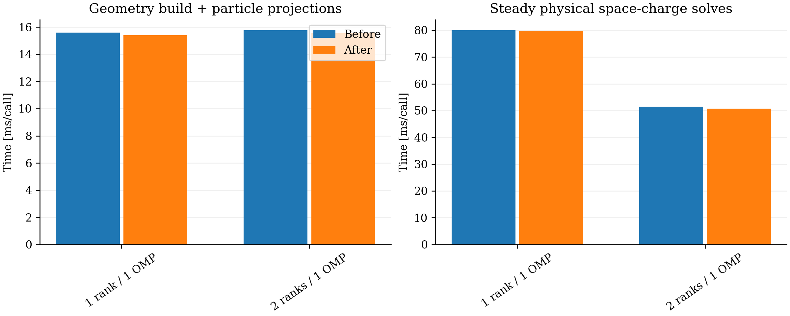
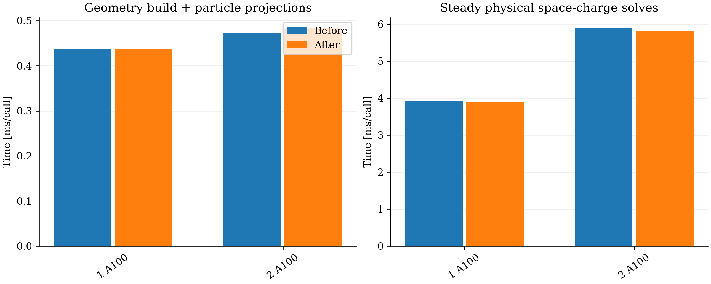

### Cleanup and CPU/GPU revalidation

Remove the IPPL comparison backend and unused code, split long solve methods into documented stage helpers, and right-size the MPI Green workspace. No IPPL library, physics model or numerical tolerance changes.

Focused CPU tests pass with 1/4 OpenMP threads and two MPI ranks. CUDA algorithm/numerical tests and one/two-rank parallel tests pass. Paired preserved/new executables run the same OPEN 100-step DBA pilot above, including longitudinal fields. All 100,000 particles and charge are preserved; maximum rms/emittance differences are **1.69×10⁻¹⁴ on CPU** and **1.35×10⁻¹⁴ on GPU**, consistent with reduction roundoff.

| Configuration | Process before → after [s] | Steady SC before → after [ms/call] |
|---|---:|---:|
| 1 CPU rank, 1 OMP thread | 16.280 → 16.153 | 79.972 → 79.777 |
| 2 CPU ranks, 1 OMP thread/rank | 8.962 → 8.874 | 51.407 → 50.687 |
| 1 A100 | 8.367 → 8.474 | 3.924 → 3.902 |
| 2 A100s | 10.959 → 10.797 | 5.882 → 5.819 |

Steady SC covers 99 solves, excluding initialization, warmup and the first physical solve. One pair per configuration; timing is essentially unchanged. Previous executables and raw runs are retained. No 16-turn runs.

[Validation, timing breakdown and provenance](https://github.com/OPALX-project/opalx-documents/blob/7ee66b7fe9d1cc4811891ddb045ef44d4e43bac1/examples/2026/2d5-1/cleanup-2026-11-07/readme.md).
